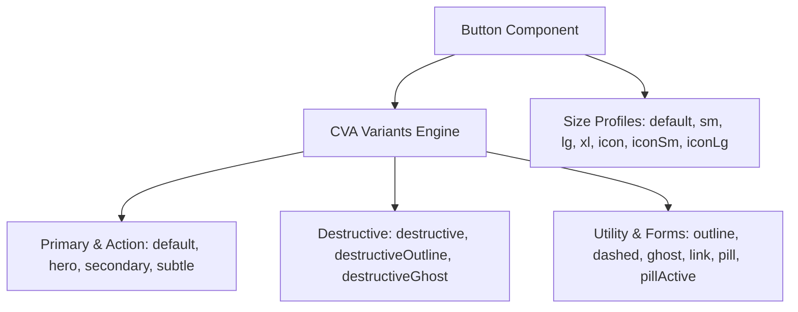

# Unified UI Component System: Button & Input Architecture

Comprehensive specification of Artpack's standardized Design System UI components, featuring Class Variance Authority (CVA) button styling variants and prefix/suffix adornment-safe input architecture.

---

## 1. Architecture & Design Principles

Artpack enforces strict design consistency across both public storefronts and creator studio panels. Instead of ad-hoc Tailwind utility classes on native `<button>` and `<input>` elements, all interactive form controls and triggers utilize reusable, strongly-typed components under `src/components/ui/`.

```
src/components/ui/
├── button.tsx           # Standardized CVA Button with 13 variants & 7 size profiles
├── input.tsx            # Adornment-safe Input with prefix/suffix & container support
├── textarea.tsx         # Unified Textarea with token styling
├── Card.tsx             # Surface primitives
└── ...
```

### Core Tenets
1. **Design System Token Fidelity**: Every button and input variant maps to a distinct semantic role (`hero`, `dashed`, `subtle`, `destructiveOutline`, etc.).
2. **TypeScript Safety**: Resolves type collisions (e.g. `HTMLInputElement.prefix`) and guarantees full type safety for adornments and props.
3. **Responsive Interactivity**: Built-in hover, active scale effects, focus rings, and transition timings across all variants.

---

## 2. Button Component Specification (`src/components/ui/button.tsx`)

Powered by `class-variance-authority` (CVA), supporting `Slot` via `@radix-ui/react-slot` for `asChild` composition.



### Variant Matrix

| Variant | Styling & Visual Intent | Usage Example |
| :--- | :--- | :--- |
| `default` | Primary brand accent with shadow | Standard form submission, primary modal action |
| `hero` | High-emphasis uppercase bold with glowing primary shadow | "Create Studio", "Launch Store", "Apply for Slot" |
| `subtle` | Soft primary background (`bg-primary/10`) with matching border | Active tier selector cards, highlighted options |
| `outline` | Neutral border with subtle hover background | Secondary options, modal cancellation, step back |
| `dashed` | Dashed border (`border-2 border-dashed border-primary/30`) | "Add Custom Tier", "Add Category", "Add Item" |
| `destructive` | High-visibility red fill with shadow | Nuclear account deletion, irreversible purging |
| `destructiveOutline`| Neutral outline with destructive red hover transition | Removing category cards, item row deletion |
| `destructiveGhost` | Transparent background with red hover state | Quick delete icons, sign-out menu triggers |
| `secondary` | Muted background with contrasting text | Alternative flows, neutral actions |
| `ghost` | Transparent surface with hover elevation | Icon toggles, close buttons, list replies |
| `link` | Underline text link styling | Inline price guide triggers, footer links |
| `pill` | Fully rounded neutral badge button | Tag filters, quick category pills |
| `pillActive` | Fully rounded primary filled badge button | Active filter pills |

### Size Matrix

| Size | Height / Dimensions | Padding / Text Size |
| :--- | :--- | :--- |
| `default` | `h-9 px-4 py-2` | Standard inline actions |
| `sm` | `h-8 rounded-md px-3 text-xs` | Compact table/row actions, category tab triggers |
| `lg` | `h-10 rounded-md px-8` | Modal footers, primary CTA bars |
| `xl` | `h-14 rounded-2xl px-8 text-base` | Hero banners, onboarding submission triggers |
| `icon` | `h-9 w-9` | Standard icon triggers |
| `iconSm` | `h-8 w-8 rounded-lg` | Row deletion buttons, copy buttons, modal close |
| `iconLg` | `h-12 w-12 rounded-2xl` | Floating lightbox controls, media zoom buttons |

---

## 3. Input Component Specification (`src/components/ui/input.tsx`)

### The Native Collision Fix
The standard DOM interface `HTMLInputElement` defines a legacy `prefix?: string` property. To allow React components to pass custom ReactNode icons or currency adornments as `prefix` and `suffix` props without TypeScript compilation errors, the interface uses `Omit`:

```typescript
export interface InputProps extends Omit<React.ComponentProps<'input'>, 'prefix'> {
  prefix?: React.ReactNode
  suffix?: React.ReactNode
  startAdornment?: React.ReactNode
  endAdornment?: React.ReactNode
  containerClassName?: string
}
```

### Layout Handling & Adornments
When `prefix` (or `startAdornment`) / `suffix` (or `endAdornment`) are provided, `Input` wraps the native element inside a flex container, positioning adornments with non-overlapping padding and consistent typography:

```tsx
<Input
  prefix={<span className="text-muted-foreground font-black">$</span>}
  placeholder="0.00"
  value={price}
  onChange={handleChange}
/>
```

---

## 4. Components Refactored Across Codebase

| Component | Path | Refactor Details |
| :--- | :--- | :--- |
| **`PlatformLandingPage`** | `src/components/platform/PlatformLandingPage.tsx` | Replaced raw CTA buttons with `<Button variant="hero" size="xl">` and header triggers |
| **`CommissionTypeTabs`** | `src/features/onboarding/components/subcomponents/CommissionTypeTabs.tsx` | Replaced tabs, preset adders, and delete triggers with `Button` variants |
| **`PricingCategoryCard`** | `src/features/onboarding/components/subcomponents/PricingCategoryCard.tsx` | Replaced delete category and add item buttons with `destructiveOutline` and `dashed` |
| **`TierItemRow`** | `src/features/onboarding/components/subcomponents/TierItemRow.tsx` | Standardized item row delete button and prefix-safe currency input |
| **`StepOfferings`** | `src/features/onboarding/components/steps/StepOfferings.tsx` | Used `Button` for category addition and tier configuration |
| **`StepAesthetic`** | `src/features/onboarding/components/steps/StepAesthetic.tsx` | Standardized aesthetic prompt selection pills and custom input |
| **`StepLaunch` & `StepMascot`** | `src/features/onboarding/components/steps/` | Standardized mascot selectors and final launch triggers |
| **`OnboardingFooter`** | `src/features/onboarding/components/OnboardingFooter.tsx` | Back/Next actions standardized with `outline` and `hero` |
| **`OnboardingProgressBar`** | `src/features/onboarding/components/OnboardingProgressBar.tsx` | Close modal button standardized with `ghost` and `icon` |
| **`LoginForm` & `RegisterForm`** | `src/features/auth/components/` | Form submit actions standardized with `variant="hero" size="lg"` |
| **`CommissionForm`** | `src/features/commissions/components/CommissionForm.tsx` | Commission submit CTA standardized with `variant="hero" size="xl"` |
| **`ProjectTierSelector`** | `src/features/commissions/components/ProjectTierSelector.tsx` | Project type selection cards refactored to use `Button variant="subtle"` |
| **`ArtistReviewForm`** | `src/features/commissions/components/review/ArtistReviewForm.tsx` | Discount row deletion and add custom discount buttons unified |
| **`CommissionSidebar`** | `src/features/commissions/components/review/CommissionSidebar.tsx` | Close drawer trigger standardized with `Button` |
| **`HeroLayout`** | `src/features/pricing/components/layouts/HeroLayout.tsx` | Zoom triggers and example triggers standardized with `ghost` and `link` |
| **`CategoryGallery`** | `src/features/pricing/components/layouts/CategoryGallery.tsx` | Prev/Next navigation controls standardized with `ghost` and `icon` |
| **`CommentsSection`** | `src/features/queue/components/CommentsSection.tsx` | Reply triggers, older thread expanders, and post message button unified |
| **`NotifyButton`** | `src/features/queue/components/NotifyButton.tsx` | Toast dismiss trigger refactored to `Button` |
| **`PaymentSuccessHandler`** | `src/features/commissions/components/review/PaymentSuccessHandler.tsx` | Toast dismiss trigger refactored to `Button` |
| **`NavHeader`** | `src/components/NavHeader.tsx` | Desktop & mobile logout actions, mobile hamburger toggle unified |
| **`ProductCarousel`** | `src/features/shop/components/ProductCarousel.tsx` | Scroll navigation buttons refactored to `<Button variant="outline" size="icon">` |
| **`AvatarUpload`** | `src/components/ui/AvatarUpload.tsx` | Modal cancel and save actions unified with `Button` |
| **`ProductImageGallery`** | `src/app/(frontend)/(studio)/shop/[slug]/ProductImageGallery.tsx` | Thumbnail selectors unified with `Button variant="ghost"` |

---

## 5. Verification & Testing Reference

### TypeScript Validation
```bash
npx tsc --noEmit
```
*Result: Clean exit with 0 errors across all routes and components.*

### End-to-End Test Suite
```bash
npx playwright test tests/e2e/artist-onboarding.e2e.spec.ts
```
*Result: 4/4 tests passed (mobile bottom sheet, multi-step flow, desktop modal, commission type presets).*
