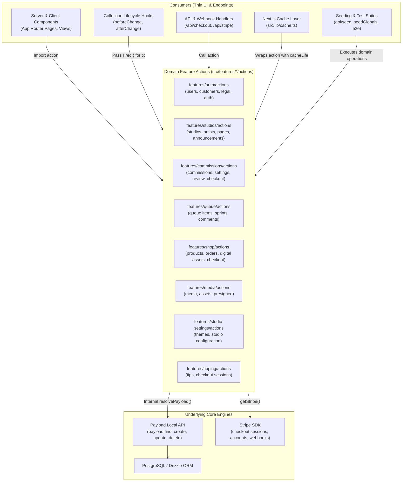

# Domain-Driven Server Actions & API Encapsulation

Architectural specification for encapsulating all Payload CMS Local API (`find`, `findByID`, `create`, `update`, `delete`, `count`, `updateGlobal`, `auth`) and Stripe API operations into single-responsibility, domain-driven Server Actions under `src/features/<feature>/actions/`.

---

## 1. Architecture Overview



---

## 2. Core Architectural Principles

### A. Zero Inline Local API & Stripe SDK Calls
No direct calls to `payload.find`, `payload.findByID`, `payload.create`, `payload.update`, `payload.delete`, `payload.count`, `payload.findGlobal`, or `stripe.*` are permitted inside:
- Next.js page components, views, or layouts (`src/app/`)
- API Route handlers (`src/app/api/`)
- Collection hooks (`src/collections/hooks/`)
- Cache definitions (`src/lib/cache.ts`)
- Seeding routines or test helpers (`src/seedGlobals.ts`, `tests/helpers/`)

All operations are isolated in dedicated `src/features/<feature>/actions/<verb>-<entity>.action.ts` files and barrel-exported from `src/features/<feature>/index.ts`.

### B. Automatic Internal Payload Resolution
Callers **never** manually instantiate or pass `payload` (`await getPayload({ config })`). Actions automatically resolve the Payload instance internally using `resolvePayload(options.payload, options.req)`:

```typescript
async function resolvePayload(providedPayload?: Payload, req?: any): Promise<Payload> {
  if (req?.payload) return req.payload
  if (providedPayload) return providedPayload
  const config = await configPromise
  return getPayload({ config })
}
```

### C. Transaction Safety via `req` Propagation
When called inside Payload collection hooks or transactional flows, callers pass `{ req }` in options. This ensures nested operations execute within the active database transaction:

```typescript
// Hook example
afterChange: [
  async ({ doc, req }) => {
    await updateArtist(doc.artist, { studios: [doc.id] }, { req })
  },
]
```

### D. Separation of Next.js 15 Cache Layer
Functions in `src/lib/cache.ts` use Next.js App Router cache primitives (`use cache`, `cacheLife`, `cacheTag`) and serve purely as caching decorators around domain actions, containing zero database query logic.

---

## 3. Feature Domain Modules & Actions

### 1. Auth & Identity (`src/features/auth`)
| Action File | Functions Exported | Description |
| :--- | :--- | :--- |
| `get-user.action.ts` | `getUserById`, `findUsers` | Query user/customer records by ID or filter criteria |
| `create-user.action.ts` | `createUserRecord` | Create new users or customers with hashed credentials |
| `update-user.action.ts` | `updateUserRecord` | Update user metadata, consents, or tenant relationships |
| `delete-user.action.ts` | `deleteUserRecord`, `deleteUsers` | Individual and bulk user deletions |
| `get-authenticated-user.action.ts` | `getAuthenticatedUser` | Extracts JWT user session from Next.js headers |
| `login-user.action.ts` | `loginUser` | Authenticates credentials and returns JWT payload |
| `legal.action.ts` | `getTermsOfService`, `getPrivacyPolicy`, `updateTermsOfService`, `updatePrivacyPolicy` | Global legal document management |

### 2. Studios & Artists (`src/features/studios`)
| Action File | Functions Exported | Description |
| :--- | :--- | :--- |
| `get-studio.action.ts` | `getStudioById`, `getStudio`, `getStudios`, `getAllStudios` | Queries multi-tenant studio organizations |
| `get-studios-for-user.action.ts` | `getStudiosForUser` | Scoped studio query for authenticated user access |
| `create-studio.action.ts` | `createStudio` | Registers a new studio tenant organization |
| `update-studio.action.ts` | `updateStudio` | Updates theme, settings, or metadata links |
| `delete-studio.action.ts` | `deleteStudio` | Deletes a studio entity |
| `check-subdomain.action.ts` | `checkSubdomainUniqueness` | Verifies handle availability against reserved list & DB |
| `artist.action.ts` | `getArtistById`, `getArtists`, `createArtist`, `updateArtist`, `deleteArtist` | Manages creator profiles within studios |
| `page.action.ts` | `getPageBySlug`, `getPages`, `createPage`, `updatePage`, `deletePages` | Tenant-scoped custom CMS layout pages |
| `announcements.action.ts` | `getAnnouncementsByTenant` | Active banner announcements for a studio |

### 3. Commissions (`src/features/commissions`)
| Action File | Functions Exported | Description |
| :--- | :--- | :--- |
| `get-commission.action.ts` | `getCommissionById`, `getCommissions`, `countCommissions` | Queries commission submissions |
| `create-commission.action.ts` | `createCommission` | Creates a new commission request record |
| `update-commission.action.ts` | `updateCommission` | Modifies commission quote, status, or progress |
| `delete-commission.action.ts` | `deleteCommission`, `deleteCommissions` | Removes commission records |
| `commission-settings.action.ts` | `getCommissionSettingsById`, `getCommissionSettingsByTenant`, `createCommissionSettings`, `updateCommissionSettings`, `deleteCommissionSettings`, `deleteCommissionSettingsByQuery` | Pricing tiers, block layout, and AI guidelines |
| `commission-review.action.ts` | `reviewCommissionAction`, `rejectCommissionAction`, `retriggerAIAnalysisAction` | Artist review, pricing approval, and AI estimate flows |
| `create-commission-checkout.action.ts` | `createCommissionCheckoutSession` | Generates Stripe Checkout sessions with Connect destination charges |

### 4. Queue & Sprints (`src/features/queue`)
| Action File | Functions Exported | Description |
| :--- | :--- | :--- |
| `get-queue-item.action.ts` | `getQueueItemById`, `getQueueItemByCommissionId`, `getQueueItems`, `getQueueItemsByTenant`, `getQueueByTenant` | Production pipeline queue cards |
| `create-queue-item.action.ts` | `createQueueItem` | Adds a commission to the active production queue |
| `update-queue-item.action.ts` | `updateQueueItemRecord`, `updateQueueItems` | Updates checklist, status, or order |
| `delete-queue-item.action.ts` | `deleteQueueItemRecord`, `deleteQueueItems` | Purges queue items |
| `get-sprint.action.ts` | `getSprintById`, `getSprints`, `getActiveSprints`, `getActiveSprintForTenant`, `getSprintsByTenant`, `getSprintCountForTenant` | Batch sprint periods |
| `create-sprint.action.ts` | `createSprint` | Opens a new commission batch sprint |
| `update-sprint.action.ts` | `updateSprintRecord`, `updateSprints` | Modifies sprint capacity or dates |
| `delete-sprint.action.ts` | `deleteSprintRecord`, `deleteSprints` | Deletes sprint batches |
| `queue-comment.action.ts` | `createQueueCommentRecord`, `deleteQueueCommentsByQueueItem` | Public/private comment stream records |
| `comment-actions.ts` | `postCommentAction`, `deleteCommentAction`, `notifyCustomerAction` | Rate-limited user comment submission & email dispatch |

### 5. Shop, Orders & Digital Assets (`src/features/shop`)
| Action File | Functions Exported | Description |
| :--- | :--- | :--- |
| `get-product.action.ts` | `getProductById`, `getProductBySlug`, `getProducts`, `getProductsByTenant` | Storefront product listings |
| `create-product.action.ts` | `createProduct` | Creates store items |
| `update-product.action.ts` | `updateProduct` | Updates pricing or inventory |
| `delete-product.action.ts` | `deleteProduct` | Deletes store products |
| `digital-asset.action.ts` | `getDigitalAssetById`, `createDigitalAsset`, `deleteDigitalAsset` | Protected download assets and course materials |
| `get-order.action.ts` | `getOrderById`, `getOrders`, `getOrdersByCustomer`, `getOrdersByUserAndTenant`, `checkAssetAccess`, `checkProductOwnership`, `checkUserPurchasedProducts`, `countOrders` | Order history & DRM entitlement checks |
| `create-order.action.ts` | `createOrder` | Creates order records upon Stripe payment |
| `update-order.action.ts` | `updateOrder` | Updates order fulfillment status |
| `create-shop-checkout.action.ts` | `createShopCheckoutSession` | Initiates digital marketplace Stripe Checkout |

### 6. Media & Storage (`src/features/media`)
| Action File | Functions Exported | Description |
| :--- | :--- | :--- |
| `get-media.action.ts` | `getMediaById`, `getMediaByIds`, `getMedia` | Retrieves media assets |
| `create-media.action.ts` | `createMedia` | Stores file buffers and uploads |
| `delete-media.action.ts` | `deleteMedia`, `deleteMediaByQuery` | Removes media attachments |

### 7. Studio Settings & Themes (`src/features/studio-settings`)
| Action File | Functions Exported | Description |
| :--- | :--- | :--- |
| `theme.action.ts` | `getThemeById`, `getThemeByTenant`, `createTheme`, `updateTheme`, `deleteTheme`, `deleteThemes` | Visual branding tokens and layout styles |
| `get-effective-theme.action.ts` | `getEffectiveTheme` | Resolves active studio theme with draft/published fallback |
| `save-studio-settings.action.ts` | `saveStudioSettingsAction` | Composite server mutation for studio profile, theme, and pricing |

### 8. Tipping (`src/features/tipping`)
| Action File | Functions Exported | Description |
| :--- | :--- | :--- |
| `get-tip.action.ts` | `getTipById`, `getTips` | Tipping transactions |
| `create-tip.action.ts` | `createTip` | Creates tip records |
| `update-tip.action.ts` | `updateTip` | Updates tip fulfillment |
| `create-tip-checkout.action.ts` | `createTipCheckoutSession` | Connect destination checkout session for tips |

---

## 4. Refactored Consumers Breakdown

### A. Routes & App Pages
- `src/app/(app)/dashboard/DashboardMainContent.tsx`: Calls `getCommissions`.
- `src/app/(frontend)/(studio)/register/social-confirm/SocialConfirmContent.tsx`: Calls `getTermsOfService`, `getPrivacyPolicy`.
- `src/app/(frontend)/studios/page.tsx`: Calls `getUserById`, `getStudiosForUser`, `getAllStudios`.
- `src/app/sitemap.ts`: Calls `getProducts`.
- `src/app/api/auth/payload-sync/route.ts`: Calls `findUsers`, `updateUserRecord`.
- `src/app/api/checkout/route.ts`: Calls `createShopCheckoutSession`.
- `src/app/api/tips/checkout/route.ts`: Calls `createTipCheckoutSession`.
- `src/app/api/submit-commission/route.ts`: Calls `createCommission`.

### B. Collection Lifecycle Hooks
- `src/collections/hooks/createTenantOnArtistSignup.ts`: Uses `checkSubdomainUniqueness`, `createArtist`, `createStudio`, `createTheme`, `createCommissionSettings`, `updateArtist`, `updateStudio`.
- `src/collections/hooks/notifyCustomerOnPaymentSuccess.ts`: Uses `getUserById`.
- `src/collections/hooks/notifyCustomerOnReviewComplete.ts`: Uses `getUserById`.
- `src/collections/hooks/notifyDiscordOnCustomerComment.ts`: Uses `getQueueItemById`.
- `src/collections/hooks/notifyDiscordOnPaymentSuccess.ts`: Uses `getUserById`.
- `src/collections/hooks/notifyDiscordOnSubmission.ts`: Uses `getUserById`.
- `src/collections/hooks/syncProductToStripe.ts`: Uses `getMediaById`, `updateProduct`.
- `src/collections/Commissions.ts`: Uses `deleteQueueItems`.
- `src/collections/Queue.ts`: Uses `getQueueItemById`, `deleteQueueCommentsByQueueItem`.
- `src/collections/Pages.ts`: Uses `getStudioById`.

### C. Seeding & Test Harness
- `src/seedGlobals.ts`: Uses full suite of domain actions to initialize globals, studios, products, and batches.
- `src/app/(frontend)/api/seed/route.ts`: Uses domain actions for automated test environment bootstrapping.
- `src/lib/infra/cleanup.ts`: Uses domain actions for relational data detachment and entity purging.
- `tests/helpers/seedCustomer.ts`, `seedProduct.ts`, `seedQueue.ts`, `seedUser.ts`: Standardized on feature actions.

---

## 5. Verification & Testing Reference

- **TypeScript Compilation**:
  ```bash
  npx tsc --noEmit
  ```
- **Integration Test Suite**:
  ```bash
  npm run test:int
  ```
- **Playwright End-to-End Suite**:
  ```bash
  npm run test:e2e
  ```
