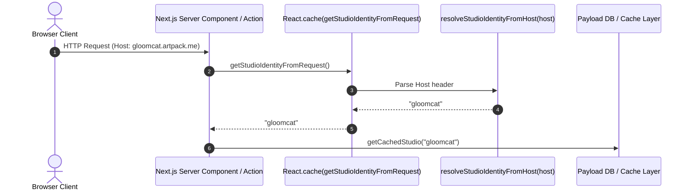
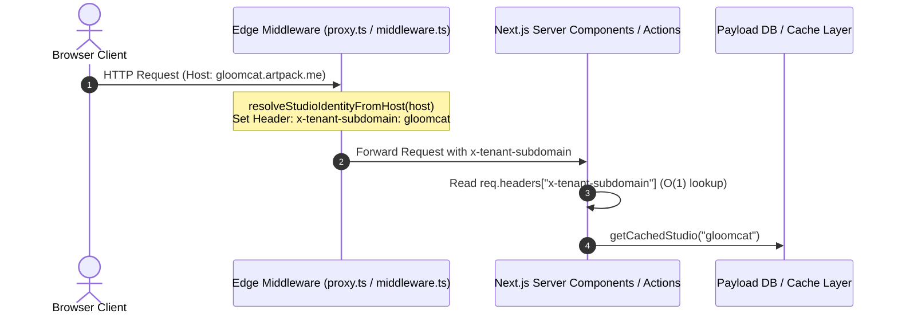

# Edge Middleware Subdomain & Multi-Tenant Header Injection

## Overview

This document describes a proposed performance and architectural improvement for multi-tenant resolution across the platform: **Edge Subdomain Extraction & Header Injection**.

---

## Current Architecture vs. Proposed Improvement

### Current State
Currently, `getStudioIdentityFromRequest()` in `src/lib/tenant/subdomain.ts` is called in ~30 locations across Server Components, cache actions, layout components, and route handlers. It extracts the HTTP `Host` header via `next/headers` and parses it using `resolveStudioIdentityFromHost(host)` inside a `React.cache()` wrapper.



### Proposed Edge Middleware Injection

Instead of each Server Component / Action resolving the raw Host string, **Next.js Edge Middleware** parses the `Host` header at the edge once and injects a normalized `x-tenant-subdomain` header into the downstream request pipeline.



---

## Why Avoid Full Path Rewriting (`/_sites/[subdomain]`)

In standard multi-tenant templates, middleware rewrites URLs from `tenant.artpack.me/path` to `/_sites/tenant/path`. In this application, **full path rewriting is intentionally avoided** because:

1. **Payload CMS 3.0 Compatibility**: Payload manages its own internal router for `/admin`, `/api/graphql`, and REST endpoints. Rewriting internal paths breaks Admin Panel asset loading, session cookies, and route handlers.
2. **Next.js 15 `'use cache'` Tag Invalidation**: Tag-based caching (`revalidateTag("artist-gloomcat")`) is decoupled from URL hierarchy. Keeping flat routes (`/`, `/queue`, `/studios`, `/login`) ensures consistent cache boundaries.

---

## Implementation Steps

### 1. Edge Middleware (`src/middleware.ts` or `src/proxy.ts`)

```typescript
import { NextResponse, type NextRequest } from 'next/server'
import { resolveStudioIdentityFromHost } from '@/lib/subdomain-host'

export function middleware(request: NextRequest) {
  const host = request.headers.get('host') || ''
  const subdomain = resolveStudioIdentityFromHost(host)

  // Clone headers and inject normalized tenant subdomain
  const requestHeaders = new Headers(request.headers)
  requestHeaders.set('x-tenant-subdomain', subdomain)

  return NextResponse.next({
    request: {
      headers: requestHeaders,
    },
  })
}

export const config = {
  matcher: [
    /*
     * Match all request paths except:
     * - _next/static (static files)
     * - _next/image (image optimization files)
     * - favicon.ico, sitemap.xml, robots.txt
     */
    '/((?!_next/static|_next/image|favicon.ico|sitemap.xml|robots.txt).*)',
  ],
}
```

### 2. Fast Header Resolution Helper (`src/lib/tenant/subdomain.ts`)

```typescript
import { headers } from 'next/headers'
import { cache } from 'react'
import { resolveStudioIdentityFromHost } from './subdomain-host'

export const getStudioIdentityFromRequest = cache(async (): Promise<string> => {
  const headersList = await headers()
  
  // 1. Fast path: Read pre-calculated subdomain from Edge Middleware header
  const preCalculated = headersList.get('x-tenant-subdomain')
  if (preCalculated) return preCalculated

  // 2. Fallback: Parse host header directly (for local unit tests or isolated invocations)
  const host = headersList.get('host') || ''
  return resolveStudioIdentityFromHost(host)
})
```

---

## Benefits

1. **Edge-Level Normalization**: Early tenant resolution at the edge allows for immediate edge-level redirects, security blocking (e.g. banned subdomains), or geofencing without invoking Node.js server runtimes.
2. **Backward-Compatible**: Completely transparent to existing Server Components, Server Actions, and `src/lib/cache.ts`.
3. **Fail-Safe Fallback**: Retains direct Host parsing as a fallback for unit tests and local scripts where middleware does not execute.
