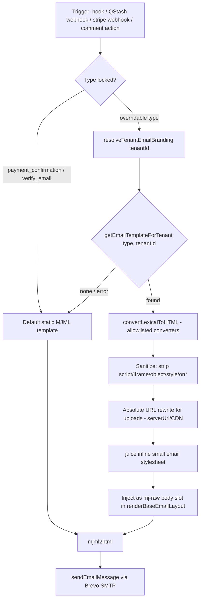

# Email Template Customization — Lexical-Based Per-Tenant Email Bodies

> **Status: SPEC (tech debt). Not implemented.** This document is the design decision record and implementation plan for letting artists customize their transactional email bodies. It follows the investigation done on the `email-multi-tenant` branch (PR #38) and the review fixes that followed.

---

## Overview

Artists (studio tenants) want their emails to speak in their own brand voice — custom copy, images, and layout of the email **body** — while the platform keeps the **header** (logo/studio name) and **footer** (copyright, receiving-note) consistent across all tenants.

**Decision: bodies are authored in Payload's Lexical rich-text editor (structured content), NOT raw MJML/HTML.** The Lexical JSON is converted to HTML at send time, sanitized and style-inlined, and slotted into the shared branded MJML layout as the body.

### Why not raw MJML editing (decision record)

Raw MJML was considered and rejected for three reasons:

1. **Server file read (LFI).** The installed `mjml-core` XML parser supports `<mj-include path="...">`, which reads files **from disk** at render time. `src/lib/email/render.ts` does not set `ignoreIncludes` or a restricted `filePath`, so an artist-authored template could embed `.env`, `package.json`, or any readable file into an email sent to an address the artist controls — a stored exfiltration channel, not a request-time injection.
2. **Arbitrary HTML passthrough.** `<mj-raw>` / `<mj-html>` would let stored markup flow into emails sent from the platform's verified Brevo sender domain to customers (tracking, phishing-looking content), bypassing the `escapeHtml` boundary applied in the current templates.
3. **Adoption.** MJML is a developer markup language. The artists this platform serves edit pages and blocks with Payload's lexical editor already — that is the editing surface they know.

Lexical output is constrained to its configured node types, so neither file reads nor raw HTML passthrough can exist in the source content.

### Package research (verified 2026-08-29)

- **No Lexical→MJML package exists on npm** (search returns only the Lexical framework). MJML is a means to HTML; converting to MJML components would reimplement MJML semantics for zero gain since the output is HTML anyway. The correct target is **Lexical → email-grade HTML**.
- **`@payloadcms/richtext-lexical/html`** (already installed) exports the new **sync** converter: `convertLexicalToHTML` + `defaultHTMLConverters` with individual converters (`UploadHTMLConverter` → ``, heading, list, link, table, blockquote, horizontalRule, text). It natively understands Payload node shapes (`upload` serializes as `value: { relationTo, value }`) — zero shape-mapping. The old `lexicalToHtml_deprecated` path is marked "will be removed in 4.0" — do not use it.
- **`@tryghost/kg-lexical-html-renderer` v1.5.0** exists ("Renders serialized Lexical state to front-end or email HTML for Ghost") but speaks Ghost node formats, requiring adapter code for Payload shapes. Rejected in favor of Payload's own converter.
- **`juice`** is already present in `node_modules` (mjml dependency) for inlining the small email stylesheet.

---

## Architecture

### Send-path pipeline

The existing pattern is preserved: any failure along the custom path (conversion error, missing doc, sanitizer reject) falls back to the current static template — the same graceful-fallback chain the branding resolver already uses.

### Overridable vs locked types

| Type | Overridable | Rationale |
|---|---|---|
| `approval`, `rejection`, `progress_update`, `commission_received` | ✅ | Core artist↔customer communication; brand voice matters most here. |
| `tip_received`, `purchase_confirmation` | ✅ (v1.1 optional) | Marketing-adjacent; ship after the core set. |
| `payment_confirmation` | ❌ locked | Financial receipt — must stay platform-owned. |
| `verify_email` | ❌ locked | Platform authentication email (`Customers.ts` calls `verifyEmailTemplate` directly). Its body already renders the requesting studio when one is resolvable (`resolveAuthEmailBranding`: `req.context.tenantId`, else the request subdomain) and falls back to the platform name via `getDefaultStudioName()`; the activation link always stays on `NEXT_PUBLIC_SERVER_URL`. |

---

## Component Breakdown (planned files)

### New — collection

- **`src/collections/EmailTemplates.ts`** — `emailTemplates` collection:
  - `tenant` — relationship → `studios`, required, index
  - `type` — select: `approval | rejection | payment_success | progress_update | commission_received | tip_received | purchase_confirmation` (locked types simply have no doc)
  - `subject` — text, required when doc exists, max length ~150, escaped on use
  - `previewText` — text (email preheader), escaped on use
  - `body` — `richText`, `editor: lexicalEditor()` with a **restricted feature set** (paragraph, heading, list, link, upload, linebreak, horizontalRule, blockquote; NO HTML node, NO table in v1)
  - `admin.group`: `ADMIN_GROUPS` studio marketing/communication group; `useAsTitle: 'type'`
  - Unique index on `(tenant, type)`; `access`: create/update/delete for studio owner or platform admin; read tenant-scoped (own studio + admin)
  - Hooks: `beforeValidate`/`beforeChange` validation of subject length; nothing else (no email side effects)

### New — feature module (per AGENTS feature-first convention)

- **`src/features/email-templates/actions/get-email-template.action.ts`** — `getEmailTemplateForTenant(type, tenantId, { req }) → EmailTemplate | null`; internal `resolvePayload` pattern; `overrideAccess` default per existing actions.
- **`src/features/email-templates/actions/upsert-email-template.action.ts`** — admin-facing save (create-or-update on the `(tenant, type)` unique pair); validates `type` is in the overridable set (defense in depth — locked types rejected server-side).
- **`src/features/email-templates/index.ts`** — barrel exports.

### New — conversion module

- **`src/lib/email/lexical-body.ts`** — the only genuinely new logic (~100–150 lines):
  - `serializeLexicalEmailBody(data: SerializedEditorState, branding: TenantEmailBranding): Promise<string>`
  - Uses `convertLexicalToHTML` from `@payloadcms/richtext-lexical/html` with an **allowlisted converter set** (drop table/HTML converters)
  - Sanitizes output (allowlist tags/attrs; strip `script|iframe|object|style|on*`)
  - Rewrites upload URLs to absolute (`serverUrl` / CDN) — extract and reuse the logo-URL prefixing logic from `tenant-branding.ts` into a shared `resolveAbsoluteMediaUrl(url, serverUrl)` helper
  - Inlines a tiny email stylesheet via `juice` (e.g. `h1/h2 { margin, font-size, color: primaryColor }`, `a { color: primaryColor }`, `img { max-width: 100% }`, `ul/ol { padding-left }`)
  - Returns email-ready HTML or throws → caller falls back to the default template

### Modified — send path

- **`src/lib/email.ts`** — each overridable `send*Email` gains, after branding resolution: lookup template override → if body present, `serializeLexicalEmailBody(...)` → pass the HTML body into the template/layout. Subject: `template.subject || current subject`.
- **`src/lib/email/templates/common.ts`** — `renderBaseEmailLayout` accepts an optional raw-HTML body slot rendered via `<mj-raw>` inside a section (chrome/header/footer unchanged). Default templates continue passing the existing MJML `content` string.
- **`src/collections/Customers.ts`** — no change (verify stays platform-owned).

### Optional — admin preview (v1.1)

- **`src/features/email-templates/components/EmailTemplatePreview.tsx`** — renders the compiled email (conversion + layout) for the current studio branding in an `iframe sandbox` (no `allow-scripts`), server-side.

---

## Security & Guardrails

1. **Editor constraint**: the lexical config for the `body` field allowlists node features; the HTML node is disabled at the editor level, not just the serializer.
2. **Serializer allowlist**: even if a node sneaks into stored JSON, the converter set excludes it (unknown nodes → skipped, not rendered).
3. **Post-conversion sanitize**: defense in depth — the output HTML passes an allowlist sanitizer before juice-inlining.
4. **No render-time MJML from tenant content**: tenant content is injected as already-converted, sanitized HTML. `renderMJML` is never called with tenant-authored MJML, so the `mj-include` LFI surface stays closed.
5. **Server-side tenant resolution**: the template doc is looked up by the same server-derived `tenantId` used for branding (`doc.tenant` / `resolveTenant`). Client-supplied tenant IDs are never accepted.
6. **Locked types enforced twice**: no UI path (select options exclude locked types in v1) and the upsert action rejects locked `type` values server-side.
7. **Access control**: only the studio owner / platform admin can create or update templates; reads are tenant-scoped. Other studios can never read or inherit another tenant's template.
8. **Known accepted residual risks**: artists can embed their own tracking pixels via uploaded images (their own brand's email — acceptable), and links can point at third-party domains from the verified sender (add a send-time link warning in v2 if abuse appears).

---

## Performance & Caching

- Lexical→HTML conversion is a **pure serializer** (no network, no heavy parse) — safe to run at send time; no caching required for v1.
- Do **not** cache rendered HTML keyed only by `(tenant, type)` without a version/`updatedAt` component; if caching is added later, tag with `email-template-${id}-${updatedAt}`.
- Sends remain behind the existing QStash queue for hooks (`queueOrSendCommissionEmail`), so the added lookup + conversion happens off the write path for commission emails.

---

## Testing Plan

- **Unit** (`tests/int/email-lexical-body.int.spec.ts`): converter allowlist (table/html nodes dropped), sanitizer (script/on* stripped), absolute URL rewrite, juice inlining, empty-body → throw.
- **Int**: `getEmailTemplateForTenant` fallback (no doc → default template path); unique `(tenant, type)` enforcement; locked-type upsert rejection; access control (non-owner cannot create).
- **E2E (optional)**: artist saves a body in admin → commission approval triggers email containing the custom copy and studio branding.

---

## Debug Reference

- **Logs**: `[EMAIL-TEMPLATE]` prefix for lookup/conversion; `[EMAIL ERROR]` (existing) for send failures; `[TENANT-BRANDING]` for branding resolution. Fallback events log at warn level: `[EMAIL-TEMPLATE] Falling back to default template for type=X tenant=Y`.
- **Admin verification**: open the `emailTemplates` collection in a studio's admin → create a doc for `approval` → save → trigger a commission review; check the sent/mock-logged email (`[MOCK-EMAIL]` logs the from/subject; `EMAIL_MOCK_MODE=true` mocks all sends).
- **Common failure modes**: custom body missing → default template (expected); image broken → upload URL rewrite produced a relative URL (check `resolveAbsoluteMediaUrl`); unstyled email → juice step skipped (converter output injected without inlining).

---

## Open Questions (defer to implementation)

1. Subject editing scope — allow per-type subject override for all overridable types in v1, or body-only first?
2. Variant bodies (A/B testing, locales) — deferred; the `(tenant, type)` unique index keeps this extensible (add a `variant` field later).
3. Should `tip_received`/`purchase_confirmation` ship in v1 or v1.1?
4. Send-time link scanning/warning for external domains — v2.

## Related Docs

- `docs/legal-host-split-and-library-fulfillment.md` — async email/webhook offload patterns (`shouldOffloadToQStash`)
- `docs/stripe-connect-destination-charges.md` — webhook → action encapsulation style
- `docs/domain-driven-server-actions-and-api-encapsulation.md` — action patterns for the new feature module
- `src/lib/email/tenant-branding.ts`, `src/lib/email/templates/common.ts`, `src/lib/email/queue.ts` — the pipeline this feature extends
