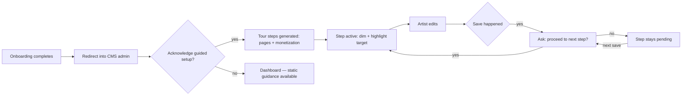

# Guided Studio Setup Tour & System Pages Guidance

> **Status**: IMPLEMENTED
> **Related**: `docs/monetization-listing-gates-and-subscriptions.md` (the tour's step 6 = Stripe Connect monetization + step 7 = publish), `docs/admin-ux-information-architecture-and-dashboard.md` (custom admin views targeted by the tour).

## Overview

Every studio starts with six system pages generated at onboarding: **Home, Commission Prices (`/prices`), Work Queue Status (`/queue`), Digital Shop (`/shop`), Privacy Policy, Terms of Service**. The setup guidance architecture provides two complementary layers:

1. **Static Guidance Layer (Admin, always available)**:
   - `src/lib/system-pages-guide.ts`: Single source of truth detailing purpose, automatic parts, customizable sections, and action requirements for each page.
   - `PagesListView`: Collapsible "How My Studio Pages Work" guide accordion, "Starter" pills on untouched rows, and high-visibility "Action Needed" alerts on unedited legal pages.
     - **Follow-up (2026-10-07)**: the guide accordion was removed as noise (see `docs/studio-ux-fixes-plan.md`, item 10 — guidance now lives in the Pages & Legal topic tour only); the dead `system-pages-guide.ts` module was deleted. "Starter" pills and "Action Needed" legal alerts remain in `PagesListView`.
   - Retemplated default legal seeds with explicit placeholders (`[Your Studio Name]`, `[Your Contact Email]`, `[Refund Policy]`).

2. **Interactive Guided Setup Tour (In-house spotlight runner)**:
   - `src/components/admin/tour/StudioSetupTour.tsx`: Immersive backdrop dimming (`rgba(5, 7, 15, 0.72)` + blur), target element highlighting (`box-shadow` spotlight with animated liquid-glow outline), step progress counter, and smart positioning.
   - `src/components/admin/tour/StudioSetupWidget.tsx`: Persistent launcher pill in the admin header (`⚡ Setup Guide (3/7)`).
   - **Save-Gated Progression**: Intercepts document save events and presents an interactive confirmation modal (*"Changes Saved! Ready to move to the next step: [Next Step Name]?"* with *"Proceed to Next Step ➔"* or *"Keep Editing This Page"*).

---

## 7-Step Tour Scope

1. **Home Hero & Branding**: Personalize studio title, tagline, and artist intro description.
2. **Pricing Tiers & Sample Artwork**: Set base prices and upload sample artwork for drawing tiers in Commission Settings.
3. **Prices Page & Commission FAQ**: Understand automatic pricing rendering and add custom turnaround time (TAT) and FAQ blocks.
4. **Queue Board & Workflow Checklist**: Understand the live queue board and customize default milestone tasks (Sketch → Line Art → Color → Final) in Commission Settings -> Workflow Checklist.
5. **Legal Terms Personalization**: Replace ToS and Privacy starter template placeholders with studio policies.
6. **Connect Stripe Express Payouts**: Connect Stripe Express to enable paid checkouts and unlock platform marketplace directory listing.
7. **Publish & Launch Studio**: Preview live storefront and publish studio to the world.

---

## Verified current state (facts)

- Six system pages per studio, created by `createDefaultPagesForTenant` at the end of onboarding (`artist-onboarding.action.ts` step 12), each from shared templates in `src/lib/blocks/createDefaultPages.ts`.
- `Prices`/`Queue`/`Shop` carry `pageType` + a dynamic auto-rendered block (fed from commission settings, queue, products); artists may only add custom blocks below. Slugs are locked (`enforcePageTypeRules`), Home slug is locked; `src/lib/blocks/systemPages.ts` (`SYSTEM_PAGE_SLUGS`, `SYSTEM_PAGE_TYPES`) is the single source of truth for protected pages.
- Legal host split (documented in `docs/legal-host-split-and-library-fulfillment.md`): platform hosts serve `PrivacyPolicy`/`TermsOfService` **globals**; studio hosts serve the studio's Pages docs — studio hosts never fall back to platform globals.
- **Legal template problem**: seeded privacy/ToS text is static boilerplate in a platform-ish voice ("Information We Collect", "No refunds after coloring…") — legally risky if artists publish it unedited. Legal pages are the highest-risk starter content.
- Admin surfaces the tour must target: stock Payload views (fields render stable `id="field-<name>"` anchors) **and** fully custom views with no Payload anchors — `PagesListView` (list), `CommissionSettingsAdminView` (edit + payouts tab), custom dashboard (`DashboardViewServer`). At ≤1440px the sidebar is portaled to `<body>` (`ResponsiveNavPortal`); drawers and the lexical toolbar also portal with high z-indexes.

---

## Part 1 — Static guidance layer (companion, always available)

Single source of truth module (same pattern as `src/lib/utils/admin-ia.ts`):

```
src/lib/system-pages-guide.ts   → per page: purpose · automatic parts · editable parts · tips · tier
```

1. **`PagesListView` panel** — collapsible "How my pages work": one card per system page with automatic-vs-editable bullets.
2. **"Starter" pill** on rows never edited since creation (`updatedAt === createdAt`) so artists see which pages still need personalization.
3. **Edit-view hint banner** on system pages — e.g. Prices: *"The price list renders automatically from your Commission Settings — edit the list there, add custom content below."* Implemented as a `ui` field / edit-view component gated on `pageType`/`isSystem`.
4. **Legal tier** — Privacy Policy & ToS get a stronger "Action needed — personalize before you launch" state (distinct from cosmetic pages), driven by a template fingerprint so untouched legal content is reliably detected.
5. **Retemplate the legal seeds** — placeholder-driven text (`[Your Studio Name]`, `[Describe your refund policy]`) or versioned template marker; never publish platform-voiced boilerplate as a studio's binding terms.

---

## Part 2 — Interactive guided tour

### Flow



- **Step model** (declarative config module, one file):

```
step = {
  id, title, tips[],
  route: '/admin/collections/pages/{id}',
  target: 'data-guide-target="home-hero"' | '#field-title' | '.nav__link[href*=pages]',
  completion: { on: 'save', collection: 'pages', field?: 'blocks' }
            | { on: 'webhook', condition: 'stripeChargesEnabled' }   // Stripe step
            | { on: 'manual' },                                        // skip/next
}
```

- **State machine**: `pending → active → done | skipped`, persisted in `localStorage` under `artpack_studio_setup_tour_v1_{tenantId}` (plus the bare key for the no-tenant case) so progress survives reloads. The tenant comes from the `payload-tenant-context` cookie, validated against `user.tenants` (`resolveClientTenantId`) — a stale cookie can no longer point the tour at another studio's progress. **Known gap:** the key is per tenant, not per tenant+user, so two artists sharing one browser *and* one studio share progress; closing that needs the user id in the key (and the e2e seeds in `tests/e2e/setup-tour-*.e2e.spec.ts` updated to match). A Payload-backed `setupTours` collection was considered and is not needed while state is client-only.
- **Save-gated advancement**: subscribe to `useFormSubmitted` / document-save events rather than polling; "Not yet" leaves the step pending and re-prompts on the next save.
- **Runner is intentionally small**: scrim + highlight box + tooltip + event subscription; the real work is step content and anchors.
- **Anchors**: `data-guide-target` attributes sprinkled on our own custom components; Payload's stable `id="field-<name>"`/`.nav__link` for stock views. All selectors live in the step-config module so breakage is one file to fix, guarded by an e2e test asserting every anchor resolves.

### Proposed step scope

1. Home — personalize hero (title/subtitle) → save
2. Prices — add FAQ below the auto-rendered price list
3. Shop — product intro / catalog check
4. Queue — explainer text above queue view
5. Legal — replace ToS/Privacy templates with real studio terms (non-skippable messaging, not blocking)
6. Monetization — **connect Stripe (per-deal fee) or subscribe** — see `docs/monetization-listing-gates-and-subscriptions.md`
7. Publish — flips `profileStatus` → studio appears on the platform directory

### Codebase-specific risks & mitigations

1. **Custom views lack Payload anchors** (`PagesListView`, `CommissionSettingsAdminView`, dashboard) — add `data-guide-target` attributes to those components.
2. **Scrim vs. portaled chrome** — sidebar portal (≤1440px), drawers, floating lexical toolbar fight a full-screen overlay. Mitigation: desktop-only scrim; on mobile fall back to **checklist mode** (step list with links, no overlay) — also satisfies the mobile-first rule.
3. **Stripe step is async + external** — onboarding runs on Stripe's own pages; the tour highlights only the "Connect Stripe" button, then waits for the `stripeChargesEnabled` webhook (can take days of review) with a "skip for now". Return from Stripe lands on the payouts tab — resume must be clean there.
4. **Payload DOM stability across upgrades** — centralize selectors in the step config; e2e anchor checks.
5. **Decline/replay** — one-time acknowledgment stored; "replay tour" entry point (help menu) and an exit that preserves progress.
6. **Tour ≠ reference** — static guidance (Part 1) stays for artists who decline or get lost mid-way.

### Runner choice (open)

- **In-house** (recommended): small runner, full control over Payload's portaled chrome and the liquid-glass theming; anchors + step content are the real effort anyway.
- **OSS lib** (driver.js / react-joyride / shepherd): faster start but fights the portaled admin DOM and the design system.

---

## Phased rollout

- **Phase A — framework + pilot**: acknowledgment modal, redirect into admin, tour runner, 2 pilot steps (Home hero → save). Proves scrim/anchor model against the real DOM.
- **Phase B — full step set**: all six pages + monetization step with webhook-wait + publish step.
- **Phase C — polish**: resume/replay/exit, per-step skip, progress UI on dashboard, mobile checklist mode, e2e coverage (`artist-onboarding.e2e.spec.ts` + new tour spec).

---

## Files touched (when implemented)

- `src/lib/system-pages-guide.ts` — guide content module (static layer)
- `src/lib/setup-tour.ts` (or `features/tours/`) — step config + types
- `src/components/admin/PagesListView.tsx` — guide panel + starter pills
- `src/collections/Pages.ts` (+ legal globals) — edit-view hint component registration
- `src/lib/blocks/createDefaultPages.ts` — legal seed retemplate
- New: tour runner components (`features/tours/components/`), acknowledgment modal, `setupTours` collection + actions, progress API
- Custom views — `data-guide-target` attributes

## Open decisions

- [ ] Tour runner: in-house vs. OSS library?
- [ ] Auto-advance vs. ask-after-every-save (UX: asking each time can annoy; asking only when the step's field changed?)
- [ ] Should the legal step be blocking (cannot publish with untouched template) or nudge-only?
- [ ] Mobile: checklist mode acceptable as the only mobile experience?
