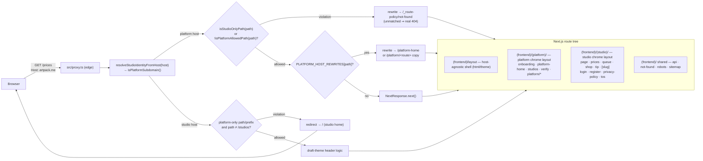

# Host–Route Policy & Platform/Studio Route Separation — Edge-Enforced Route Maps

## Overview

The platform root domains (`artpack.me` and the upcoming dedicated artpack domain, plus `localhost` in dev) and studio hosts (`gloomcat.artpack.me`, tenant apex domains like `vronyakat.com`, …) previously shared one route tree, and two classes of bugs came out of it:

1. **Root-detection drift.** The host resolver mapped the platform root domains to a marker that collided with the first tenant's studio handle (`'vronyakat'`), and ~8 call sites hand-checked `subdomain === 'root' || subdomain === 'main'` (a value only `localhost` produces). Result: on production roots, the homepage, nav, footer, and dashboard guard treated the platform as a studio — and the root rendered the first tenant's own studio homepage. The platform marker is now the neutral `'platform'` value; tenant-owned apex domains resolve to the full host and match `studios.customDomain`.
2. **Studio-content leaks on platform hosts.** Studio-only routes (`/prices`, `/queue`, `/shop`, `/tip`, and dynamic `/[slug]` CMS pages) resolve tenant data by subdomain, so on a platform host they rendered the platform owner's studio content.

The fix has three layers:

- A single `isPlatformSubdomain()` semantic replaces every hand-rolled root check.
- A declarative **route map** (`src/lib/security/route-access.ts`) defines platform-only, studio-only, and shared routes.
- The map is **enforced at the edge** (`src/proxy.ts`) before any render, with real 404s and redirects — and mirrored physically by nested route groups (`(platform)` / `(studio)`) so new pages are covered by placement.

## Architecture

- **`isPlatformSubdomain(sub)`** (`src/lib/tenant/subdomain-host.ts`) is the exact inverse of `isStudioSubdomain(sub)`: true for `'root'`/`'main'`, the neutral platform-root marker `'platform'` (what bare `artpack.me` resolves to), reserved labels (`app`, `admin`, `api`, `www`, …), and the env default.
- **The map is data, not code branches.** `route-access.ts` holds the allowlists/prefixes; the proxy only applies them. The route folders mirror the map for humans.
- **404s are real.** The proxy rewrites violations to a guaranteed-unmatched two-segment path (`/_route-policy/not-found`) so Next's router answers with a proper 404 status instead of the platform owner's studio page.

## The Route Map

- **Platform-only** (`/studios`, `/onboarding`, `/verify`, `/platform-home`, `/platform/*` shadow URLs) — studio hosts redirect to the studio home. `/studios` is exempt in the proxy: its page self-enforces with a cross-host redirect plus local session transfer.
- **Shared routes get per-host copies** (`PLATFORM_HOST_REWRITES`): `/`, `/login`, `/register`, `/forgot-password`, `/reset-password`, `/privacy-policy`, `/tos` are claimed by the studio route group; on platform hosts the proxy rewrites them to `/platform-home` or `/platform/<route>` copies. No host branch exists in any page or layout. The rewrite clones the request URL so `?token=` (password reset) and `?redirect=` (login return path) survive the hop.
- **Layouts are fully per-host**: the root layout is host-agnostic (html/theme only); `(platform)/layout.tsx` renders platform nav + unpadded main; `(studio)/layout.tsx` renders studio header + padded main + footer. Zero `isPlatformSubdomain` in any layout.
- **Studio-only prefixes** (`/prices`, `/queue`, `/shop`, `/tip`, `/theme-preview`, and anything under them — `/queue/123`, `/shop/guides`, `/tip/success`) — platform hosts get a 404. `/theme-preview` is the theme showcase: a synthetic page rendered from the studio's theme (no CMS document), used as the theme editor's live-preview target — see `docs/theme-customization-levers.md`.
- **Platform allowlist** (single segments): `/`, `/login`, `/register`, `/forgot-password`, `/reset-password`, `/verify`, `/privacy-policy`, `/tos`, `/studios`, `/onboarding`, `/sitemap.xml`, `/robots.txt`, `/favicon.ico`, `/icon.svg`. Any other single segment on a platform host is treated as a studio CMS page (`[slug]`) and 404s.
- **Platform prefixes** (multi-segment trees): `/dashboard`, `/admin`, `/api`.
- **Shared (unrestricted)**: `/login`, `/register`, `/forgot-password`, `/reset-password`, `/verify`, `/privacy-policy`, `/tos`, `/dashboard`, `/admin`, `/api/*` — valid on both host types.

## Implementation Details

### 1. Platform-host semantic (`src/lib/tenant/subdomain-host.ts`)

`isPlatformSubdomain()` added next to `isStudioSubdomain()`; both stay pure and client-safe (no `next/headers`). Uses the existing `getPlatformSubdomains()` set (reserved + platform-root markers + env default).

### 2. Route policy module (`src/lib/security/route-access.ts`)

`PLATFORM_ONLY_PATHS`, `STUDIO_ONLY_PREFIXES`, `PLATFORM_ROUTES`, `PLATFORM_PREFIXES` plus three predicates (`isStudioOnlyPath`, `isPlatformOnlyPath`, `isPlatformAllowedPath`). **Edge-safe by contract** — it is imported by the proxy and must never import `next/headers`, `next/navigation`, or node-only modules.

### 3. Edge enforcement (`src/proxy.ts`)

After the existing host resolution, the proxy applies the policy *before* the draft-theme header logic:

- Platform host + violation → `NextResponse.rewrite('/_route-policy/not-found')`.
- Studio host + `/onboarding` → `NextResponse.redirect('/')` (307).
- Everything else flows through the existing `x-draft-theme-data` logic unchanged.

Why a rewrite to an unmatched path instead of a `notFound()` page: `notFound()` thrown anywhere inside the root layout's `<Suspense fallback={null}>` wrapper degrades to a streamed error (status 200 + default 404 text + digest). The unmatched-path rewrite sidesteps that entirely and yields a genuine 404.

### 4. Route groups as the declarative map (and per-host chrome)

- Studio: `page` (home), `prices`, `queue`, `shop`, `tip`, `[slug]`, `login`, `register`, `privacy-policy`, `tos` → `(studio)/`
- Platform: `onboarding`, `platform-home`, `verify`, `studios`, `platform/{login,register,forgot-password,reset-password,privacy-policy,tos}` → `(platform)/`

The group layouts carry the chrome — `(platform)/layout.tsx` (platform nav, unpadded main, no footer) and `(studio)/layout.tsx` (studio header, padded main, footer). The shared root layout keeps only the host-agnostic shell (html, theme, analytics). URLs are unchanged (route groups are invisible to routing). Note: route segment folders must not start with `_` (Next excludes them from routing) — the platform copies live under `/platform/` for that reason; the 404 rewrite target `/_route-policy/not-found` deliberately exploits the exclusion to guarantee an unmatched path.

### 5. Shared-route copies and rewrites

`PLATFORM_HOST_REWRITES` maps the dual routes to their platform copies. The studio copies are the real paths; platform hosts get rewrites (transparent to the browser). Legal page content (`PrivacyPolicyContent`, `TosContent`) moved to `src/components/legal/` and is imported by both copies — the internal `isLanding` branch is now provably redundant per route but retained. `verify` became platform-only (verification emails only ever link to `NEXT_PUBLIC_SERVER_URL`); the password-reset link uses the same platform host, so `/forgot-password` and `/reset-password` gained platform copies too — before them, every reset link dead-ended in the platform 404 rewrite. `StudioHeader` gained an internal platform guard (platform hosts must never show studio chrome) and resolves the user itself when no token is passed — the dashboard layout passes its token, the studio layout doesn't.

### 6. Root-check sweep (the `'root' || 'main'` cleanup)

`isPlatformSubdomain()` replaced hand-rolled checks in: `HomeContent.tsx`, `(frontend)/layout.tsx` (header + main container), `(app)/layout.tsx`, `lib/dashboard-guard.ts`, `components/SiteFooter.tsx`, `(frontend)/studios/page.tsx`, `PrivacyPolicyContent.tsx`, `TosContent.tsx`, and the client-side subdomain detection in `(frontend)/not-found.tsx` (now uses `isStudioSubdomain`). `get-studio.action.ts` short-circuits (`'root'`/`'main'`) were deliberately left alone — see follow-ups.

## Files Changed

- `src/lib/tenant/subdomain-host.ts` — `isPlatformSubdomain()`
- `src/lib/security/route-access.ts` — new: route maps + predicates
- `src/proxy.ts` — edge enforcement (404 rewrite / redirect)
- `src/app/(frontend)/(platform)/layout.tsx`, `src/app/(frontend)/(studio)/layout.tsx` — new: documentation layouts
- `src/lib/security/route-access.ts` — `PLATFORM_HOST_REWRITES`, platform-only prefixes
- `src/components/StudioHeader.tsx` — internal platform guard, optional token, self-resolved user
- `src/lib/cache.ts` — `toAuthenticatedUser()` normalizer
- `src/app/(frontend)/(platform)/platform-home/page.tsx`, `(platform)/platform/{login,register,privacy-policy,tos}/page.tsx` — new platform copies
- `src/components/legal/{PrivacyPolicyContent,TosContent}.tsx` — moved out of route folders (shared by both copies)
- `(platform)/{verify,studios}/`, `(studio)/{login,register,privacy-policy,tos}/` — moved
- `(frontend)/layout.tsx` — host-agnostic root shell; `(platform)/layout.tsx` and `(studio)/layout.tsx` carry the chrome
- `src/app/(frontend)/(studio)/{prices,queue,shop,tip,[slug]}/` — moved (28 renames)
- `src/app/(frontend)/(studio)/HomeContent.tsx`, `layout.tsx`, `not-found.tsx`, `studios/page.tsx`, `privacy-policy/PrivacyPolicyContent.tsx`, `tos/TosContent.tsx`
- `src/app/(app)/layout.tsx`, `src/lib/security/dashboard-guard.ts`, `src/components/SiteFooter.tsx`
- `scripts/probe-guard.sh` — dev-server policy matrix probe (starts the server itself; the sandbox reaps background processes between tool calls, so start + probe must happen in one script)

## Debug Reference

- **Verify the policy**: `bash scripts/probe-guard.sh` — starts the dev server, hits the matrix (platform 404s, studio 200s, onboarding redirect), prints codes/titles, stops the server.
- **Port drift**: dev takes 3001 when 3000 is busy — read the `Local:` line in the log before curling.
- **Stale generated types**: after moving/deleting routes, `tsc --noEmit` can fail on `.next/**/validator.ts` referencing old paths; `rm -rf .next` regenerates it (but kills a running dev server — restart it).
- **404 theme depends on the host**: `(frontend)/not-found.tsx` sits outside both route groups and injects its own theme. It resolves the studio theme only when the host names a studio that *exists*; an unregistered handle is the platform's "claim this handle" page and must render `StaticPlatformTheme` (asking `DynamicTheme` there found no settings and used the studio generator's dark/indigo default).
- **`/my-route`** (example custom Payload route) is not in the platform allowlist and 404s on platform hosts — add it to `PLATFORM_ROUTES` or delete the scratch file.

## Known Limitations / Follow-ups

1. **Unmatched URLs still use Next's own 404 page.** The proxy's violation rewrite targets `/_route-policy/not-found`, a deliberately private (underscore-prefixed) folder, so the router answers with its built-in 404 rather than the styled component. Status-correct, but unbranded on platform hosts. The styled `(frontend)/not-found.tsx` renders whenever a page calls `notFound()` (an unregistered studio handle, a missing slug/product/queue item), and themes itself: the studio's theme when that studio exists, the platform brand otherwise (`StaticPlatformTheme`).
2. **Platform/tenant domain model (resolved).** The platform root marker is the neutral `'platform'` value (bare `artpack.me`); the first tenant's studio keeps the `'vronyakat'` handle (`vronyakat.artpack.me`) and its apex domain `vronyakat.com` resolves via `studios.customDomain`. `get-studio.action.ts` short-circuits on `isPlatformSubdomain`. Remaining: point `NEXT_PUBLIC_ROOT_DOMAIN` at the real artpack domain when it exists, and update the few hardcoded `.vronyakat.com` tenant-URL builders (`TenantSelector`).
3. **Root-domain metadata** — the platform home now has its own metadata (fixed); the root layout's title template is still owner-branded and `generateMetadata` in the layout still resolves the owner's studio settings for shared routes. Same pending decision.
4. **`/studios` on studio hosts** is self-enforced by its page (cross-host redirect + session transfer) rather than the proxy map — richer behavior, deliberately exempted.
5. **Dashboard (`(app)`) is not split per host.** Its chrome lives in the shared dashboard root layout; `StudioHeader` (component) and `SiteFooter` (component) carry the host guards there. Splitting would require duplicating the ~40-file dashboard route tree (commission/library/profile subtrees) via rewrites for no functional gain.
6. **Shadow URLs** `/platform/login` etc. are directly visitable on platform hosts (they render the same UI as the rewritten public path). Studio hosts redirect them home.
