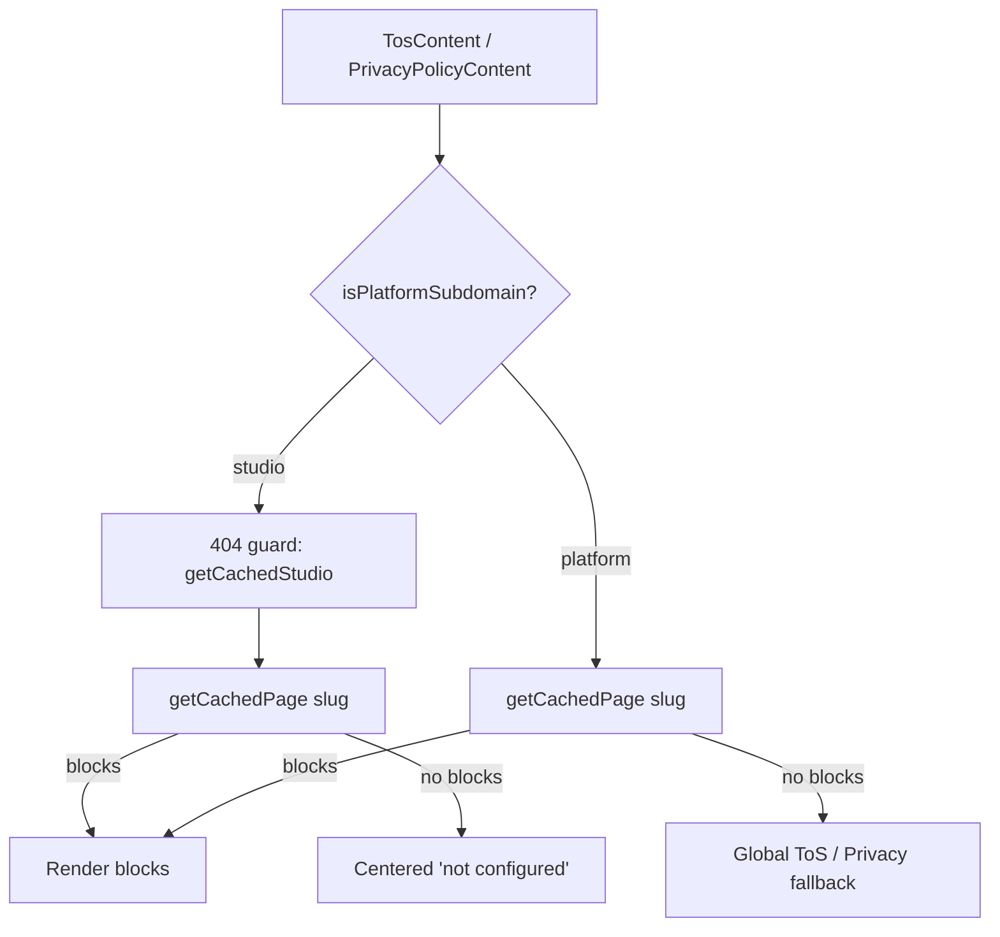
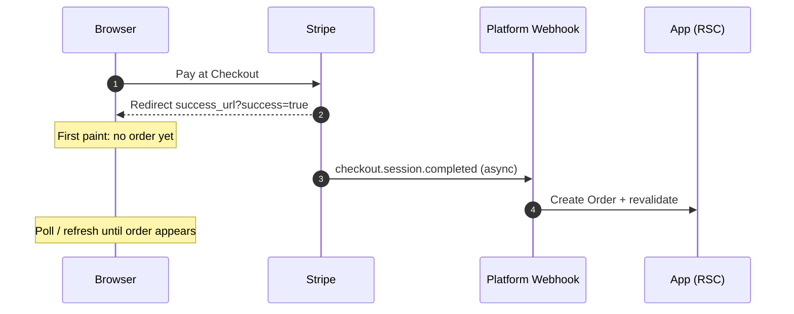
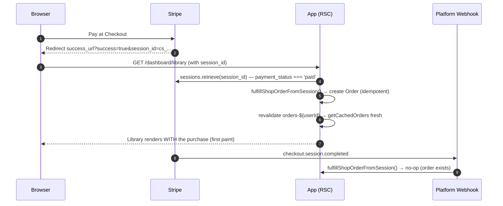

# Legal Content Host Split & Library Fulfillment Pipeline

## Overview

This document covers two refactors performed together:

1. **Legal page host split** — `TosContent` and `PrivacyPolicyContent` each contained two interleaved render branches (platform fallback to global documents vs. studio Pages-collection rendering with a 404 guard). They were split into dedicated per-host components.
2. **Library fulfillment pipeline** — the dashboard library relied on an asynchronous Stripe webhook for order creation, with a client-side polling component (`LibrarySyncManager`) masking the redirect/webhook race. Order fulfillment was moved into the success-page request path via a shared idempotent server action; async payment methods (Klarna/PayPal) were wired; and the polling workaround was removed in favor of a login return-path fix.

---

## Part 1 — Legal Content: Platform vs. Studio Split

### Before



Both components re-resolved the host, branched on `isPlatformSubdomain`, and mixed two fallback strategies in one function.

### After

```mermaid
flowchart TD
    P[(frontend)/(platform)/platform/tos] --> PT[PlatformTosContent]
    S[(frontend)/(studio)/tos] --> ST[StudioTosContent]
    PT --> P1[getCachedPage 'tos' — platform page blocks]
    P1 -- no blocks --> P2[Global ToS document sections]
    ST --> S1[404 guard: getCachedStudio]
    S1 --> S2[getCachedPage 'tos' — studio page blocks]
    S2 -- no blocks --> S3[Centered 'not configured']
```

- `src/components/legal/PlatformTosContent.tsx` / `StudioTosContent.tsx` — ToS per-host components.
- `src/components/legal/PlatformPrivacyPolicyContent.tsx` / `StudioPrivacyPolicyContent.tsx` — same split for privacy.
- Old hybrid files (`TosContent.tsx`, `PrivacyPolicyContent.tsx`) deleted; the two route pages (`(platform)/platform/tos`, `(studio)/tos`, and the privacy-policy equivalents) import their host-specific component directly.
- Rendering behavior preserved 1:1, including the subtle difference: ToS platform fallback keeps the `PageHeader` with an inline "not configured" message; the privacy platform fallback uses the centered empty state. Studio hosts never fall back to platform global documents.

### Studio-scoped library decision (context)

The same question arose for the library: show a customer's purchases across studios or per studio? Decision: **stay studio-scoped**. The dashboard guard scopes customers to the current studio tenant (`scopedTenantId`), checkout redirects to the purchasing studio's origin, and per-studio themes are applied per host — mixing studios would require per-card theme scoping. Cross-tenant aggregates (like customer commissions across artists) belong on the platform root, which is already the pattern in `requireDashboardAccess`.

---

## Part 2 — Library Content Review Fixes

`src/app/(app)/dashboard/library/LibraryContent.tsx` received five fixes:

1. **Domain logic extracted** — bundle explosion + dedup moved to `src/features/shop/actions/get-owned-library-products.action.ts` (`getOwnedLibraryProducts(orders) → Product[]`, barrel-exported from `@/features/shop`). Bundles are "exploded" into member products; the bundle itself is intentionally excluded (virtual grouping — documented in the action JSDoc).
2. **Honest error state** — `getCachedOrders` (src/lib/cache.ts) now returns `{ docs: Order[] } | null` — `null` means "tenant resolution failed", not "empty". The view renders a distinct "Couldn't load your library" card instead of a misleading empty library.
3. **Real types, no `any`** — typed with generated `Order`/`Product`/`DigitalAsset` types and `typeof x === 'object'` narrowing instead of `as any` casts.
4. **Download-link fixes** — `download={file.filename || undefined}` (attribute omitted when filename missing, previously rendered `download="true"`), removed pointless `target="_blank"`/`rel="noreferrer"` on the download endpoint.
5. **Order cache tag fix** — `fetchOrders` was tagged `orders-${userId}-${subdomain}` but the webhook revalidated only `orders-${userId}` — **the payment never invalidated the library cache**. The cache entry now also carries `orders-${userId}`, so the webhook's existing revalidation works regardless of host (subdomain or custom domain).

---

## Part 3 — Fulfillment on the Success Render (Option A)

### The race



Previously the library showed empty until the webhook landed, masked by `LibrarySyncManager` polling.

### After



**Key mechanism** — `src/features/shop/actions/fulfill-shop-order.action.ts` is the single source of truth:

1. Idempotency by `stripeSessionID` (`getOrderByStripeSessionId` → return existing order).
2. `stripe.checkout.sessions.retrieve` → gate on `payment_status === 'paid'`.
3. Gate on `metadata.orderType === 'shop'`; require `productId` + `userId` metadata.
4. **Authorization**: `expectedUserId` option — the session's `metadata.userId` must match the authenticated user on the customer-facing path.
5. Fetch primary product (depth 1), explode bundle products, resolve tenant.
6. `createOrder` (status `completed`, `stripeSessionID`), confirmation email (best effort).
7. Revalidate `orders-${userId}`, `/dashboard/library`, and `/` (on the webhook path; inside a render Next forbids tag invalidation, so the success page bypasses the orders cache with `getOrdersFresh` instead).

Both the webhook (`stripeWebhooks.ts` — slimmed from ~80 inline lines to a delegate call) and the success render (`LibraryContent` reads the `?session_id=cs_...` that Stripe substituted into `success_url` — the checkout action passes the literal `{CHECKOUT_SESSION_ID}` placeholder, because Stripe only substitutes and **never appends** the id) call the same action — whichever runs first creates the order, the other no-ops.

Stripe only redirects to `success_url` after payment succeeds, so `payment_status === 'paid'` is reliable at render time. One Stripe API call happens on the success page only.

---

## Part 4 — Async Payment Methods (Klarna / PayPal)

The checkout accepts `klarna` and PayPal in `payment_method_types`; these emit `checkout.session.async_payment_succeeded` / `async_payment_failed` instead of `checkout.session.completed`. Added:

- `handleCheckoutSessionAsyncPaymentSucceeded` — same QStash offload wrapper as the sync handler (extracted shared `shouldOffloadToQStash(req)`), then fulfills shop orders through `fulfillShopOrderFromSession`. Other order types (tips, commissions) are logged only.
- `handleCheckoutSessionAsyncPaymentFailed` — logs and acknowledges (no order ever exists for a failed payment).
- Dispatched in `src/app/api/stripe/webhooks/route.ts` and the QStash worker `src/app/api/webhooks/stripe-process/route.ts` (`async_payment_succeeded` only — failures do no DB work).

**Dashboard config required** (not code): subscribe the platform webhook endpoint to `checkout.session.async_payment_succeeded`, `checkout.session.async_payment_failed`, and optionally `checkout.session.expired`, alongside the existing `checkout.session.completed` and `account.updated`; keep "Listen to events on connected accounts" enabled.

---

## Part 5 — LibrarySyncManager Removal & Login Return Path

With Option A, first paint is correct in the designed flow, and every other arrival path is covered by the webhook + `orders-${userId}` cache revalidation. The poller was deleted (`LibrarySyncManager.tsx` removed, both call sites dropped).

The one real residual gap — **session expired between checkout and redirect**: the guard bounces to `/login`, the login round-trip dropped the query string, and the user landed on `/dashboard`. Fixed properly instead of polling:

1. `src/proxy.ts` injects a trusted `x-requested-pathname` header (same pattern as `x-draft-theme-data`).
2. `src/lib/security/dashboard-guard.ts` redirects to `/login?redirect=<path>` when the requested path is a sane `/dashboard` path (allowlist: starts with `/dashboard`, no `//`, no backslashes, ≤200 chars).
3. `src/features/auth/actions/auth-actions.ts` — customers only: honors the `redirect` param after login with the same server-side allowlist validation (artists keep their subdomain routing).
4. `src/features/auth/components/LoginForm.tsx` forwards the `redirect` query param into the login action's FormData.

Result: guard → `/login?redirect=%2Fdashboard%2Flibrary` → login → straight back to the library, which contains the order (webhook + cache revalidation ran during re-login). No polling anywhere.

---

## Files Changed

- `src/components/legal/PlatformTosContent.tsx`, `StudioTosContent.tsx`, `PlatformPrivacyPolicyContent.tsx`, `StudioPrivacyPolicyContent.tsx` (new); `TosContent.tsx`, `PrivacyPolicyContent.tsx` (deleted)
- `src/app/(frontend)/(platform)/platform/tos/page.tsx`, `(studio)/tos/page.tsx`, `platform/privacy-policy/page.tsx`, `(studio)/privacy-policy/page.tsx`
- `src/features/shop/actions/get-owned-library-products.action.ts` (new), `fulfill-shop-order.action.ts` (new), `src/features/shop/index.ts`
- `src/app/(app)/dashboard/library/LibraryContent.tsx`, `page.tsx`; `LibrarySyncManager.tsx` (deleted)
- `src/lib/cache.ts` (orders tag + null-on-failure + `Order[]` typing)
- `src/lib/stripe/stripeWebhooks.ts` (shared fulfillment delegation, `shouldOffloadToQStash` helper, async handlers)
- `src/app/api/stripe/webhooks/route.ts`, `src/app/api/webhooks/stripe-process/route.ts`
- `src/proxy.ts`, `src/lib/security/dashboard-guard.ts`, `src/features/auth/actions/auth-actions.ts`, `src/features/auth/components/LoginForm.tsx`

## Debug Reference

**Log prefixes**: `[SHOP-FULFILL]` (shared fulfillment action), `[WEBHOOK-PROCESS]` / `[WEBHOOK-OFFLOAD]` / `[WEBHOOK-CONNECT]` (webhook handlers), `[STRIPE-MANUAL-WEBHOOK]` (initial Stripe route), `[QSTASH-WORKER]` (retryable worker), `[LIBRARY-DASHBOARD]` (library view).

**Cache tags**: `orders-${userId}` (webhook revalidation target), `orders-${userId}-${subdomain}` (per-host), `orders` (global).

**QA checklist** (manual, requires test-mode Stripe):

1. Buy a course with a card → redirect → library shows the product on first paint, no toast, no empty flash.
2. Slow the webhook (e.g. pause QStash) → first paint still correct via render-path fulfillment; webhook later no-ops.
3. Expire the session between checkout and redirect → login → returns to `/dashboard/library` with the purchase present.
4. Klarna/PayPal test payment → `async_payment_succeeded` path fulfills; `async_payment_failed` logs and leaves no order.
5. Bundle purchase → children appear in library; bundle itself does not (virtual grouping).
6. Non-paid/foreign `session_id` in the URL → no order created (`expectedUserId` mismatch logs `[SHOP-FULFILL] userId mismatch`).

**Known residuals**: the `success` empty-state copy ("We're just finishing up your order…") can still appear while a genuinely in-flight async payment settles — accurate, resolved by refresh. The async-success flow cannot be exercised without a live async payment method.
