# Modular Lib Directory Architecture

Architectural specification and developer rules for the domain-driven modularization of `src/lib/`.

---

## 1. Architectural Motivation & Overview

Prior to this refactoring, `src/lib/` accumulated over 70 loose files spanning diverse domains (themes, live preview, multi-tenancy, Stripe payments, commerce formatting, page blocks, rate limiting, and cloud infrastructure) in a single unorganized directory.

To achieve strict domain encapsulation, discoverability, and clean code organization, all modules have been segregated into single-responsibility domain subdirectories. Each domain directory contains an `index.ts` barrel export.

Only **two** files are permitted at the root of `src/lib/`:
1. `src/lib/cache.ts`: Next.js App Router cache interface with `'use cache'` directives.
2. `src/lib/utils.ts`: Tailwind CSS `cn()` merger and common formatting utilities.

```mermaid
flowchart TD
    subgraph RootLib["src/lib/ (Root Directory)"]
        Cache["cache.ts\n(Next.js App Router cache)"]
        UtilsRoot["utils.ts\n(cn helper & formatters)"]
    end

    subgraph DomainModules["Domain Subdirectories (src/lib/<domain>/)"]
        direction TB
        Theme["theme/\n(theme tokens, live preview, draft codec, showcase scroll)"]
        Tenant["tenant/\n(tenant resolution, subdomains, tags, matrix facade)"]
        Security["security/\n(dashboard guard, route access, rate limiting, tokens)"]
        Commerce["commerce/\n(currency, pricing calculations, product types, carousels)"]
        Blocks["blocks/\n(page blocks, data needs, page revalidation, system pages)"]
        StripeMod["stripe/\n(Stripe client, connect auth, checkout, webhook dispatch)"]
        Infra["infra/\n(S3 multitenant, Upstash Redis/QStash, Discord alerts, cleanup)"]
        EmailMod["email/\n(email sender, MJML templates, tenant/auth branding)"]
        TourMod["tour/\n(setup guide curriculum, spotlight, state machine, placement)"]
        UtilsSub["utils/\n(id, icons, image display, lexical, motion, cdn)"]
        FetchMod["fetch/\n(typed HTTP layer & ApiError contract)"]
        PushMod["push/\n(web push notifications & VAPID payloads)"]
        MatrixMod["matrix/\n(in-memory & Redis L1/L2/L3 tenant & product matrix)"]
        AIMod["ai/\n(AI theme generation & commission estimation)"]
        LoadersMod["loaders/\n(runtime module loaders)"]
        EventBusMod["eventBus/\n(pub/sub event system)"]
    end

    Consumers["Consumers\n(App Router Pages, Server Actions, Collections, Components, Tests)"] --> RootLib
    Consumers --> DomainModules
```



---

## 2. Directory Breakdown & Mappings

| Directory | Domain Responsibility | Modules Included | Barrel Export |
| :--- | :--- | :--- | :--- |
| **`src/lib/theme/`** | Visual theme variables, live preview, draft codec & showcase synchronization | `admin-canvas-view.ts`, `live-preview.ts`, `live-preview-headers.ts`, `livePreviewEventBus.ts`, `livePreviewUrl.ts`, `preview-access.ts`, `preview-cookie.ts`, `theme-draft-codec.ts`, `theme-preview-cookie.ts`, `theme-showcase-access.ts`, `theme-showcase-scroll.ts`, `theme-variables.ts` | `src/lib/theme/index.ts` |
| **`src/lib/tenant/`** | Multi-tenant scoping, host/subdomain resolution, tags & database tenant isolation | `admin-tenant-context.ts`, `cookie-domain.ts`, `cors-origins.ts`, `extract-tenant-id.ts`, `storefront-payload.ts`, `studio-visibility-guard.ts`, `subdomain-client.ts`, `subdomain-host.ts`, `subdomain.ts`, `tenant-matrix.ts`, `tenant-payload.ts`, `tenant-tag.ts`, `tenant.ts` | `src/lib/tenant/index.ts` |
| **`src/lib/blocks/`** | Page blocks, block data requirements, system pages & page revalidation | `blocks.ts`, `blocks-ui.ts`, `block-data-needs.ts`, `effective-blocks.ts`, `createDefaultPages.ts`, `page-data.ts`, `page-revalidation.ts`, `pages-sort.ts`, `systemPages.ts` | `src/lib/blocks/index.ts` |
| **`src/lib/commerce/`** | Monetary formatting, tier image resolution, product carousels & pricing calculators | `currency.ts`, `pricing-tier-images.ts`, `product-carousel.ts`, `product-pricing.ts`, `product-types.ts` | `src/lib/commerce/index.ts` |
| **`src/lib/stripe/`** | Stripe SDK initialization, Connect onboarding, checkout origin & webhooks | `stripe.ts`, `stripeConnectAuth.ts`, `stripeWebhooks.ts`, `checkout-origin.ts` | `src/lib/stripe/index.ts` |
| **`src/lib/security/`** | Access enforcement, route guards, rate limiting, redirect sanitization & tokens | `auth.ts`, `dashboard-guard.ts`, `dashboard-routes.ts`, `route-access.ts`, `rate-limit.ts`, `redirect.ts`, `reviewTokens.ts`, `reviewValidation.ts` | `src/lib/security/index.ts` |
| **`src/lib/infra/`** | Cloud services, Redis, QStash, Discord notifications, analytics & cleanup | `s3.ts`, `upstash.ts`, `discord.ts`, `analytics.ts`, `cleanup.ts`, `safe-after.ts` | `src/lib/infra/index.ts` |
| **`src/lib/utils/`** | Cross-cutting utility helpers (prefixed IDs, icon registries, Lexical text, motion) | `admin-ia.ts`, `cdn.ts`, `commentContent.ts`, `header-stack.ts`, `icons.tsx`, `id.ts`, `image.ts`, `image-display.ts`, `is-production.ts`, `lexical-text.ts`, `motion-sanitize.ts`, `revalidate.ts`, `transactions.ts`, `upload-edits.ts` | `src/lib/utils/index.ts` |
| **`src/lib/email/`** | Transactional email dispatcher, MJML render, templates & tenant branding | `auth-branding.ts`, `base-url.ts`, `email-config.ts`, `queue.ts`, `render.ts`, `tenant-branding.ts`, `index.ts` (dispatcher), `templates/` | `src/lib/email/index.ts` |
| **`src/lib/tour/`** | Artist setup guide curriculum, spotlight, state machine & step progression | `attention.ts`, `auto-open.ts`, `curriculum.ts`, `curve.ts`, `dom.ts`, `navigation.ts`, `placement.ts`, `satisfaction.ts`, `save-gate.ts`, `spotlight.ts`, `state.ts`, `substeps.ts` | `src/lib/tour/index.ts` |
| **`src/lib/matrix/`** | Multi-tier L1 memory, L2 Redis, and L3 DB cache matrix for tenants & products | `context.ts`, `engine.ts`, `payload.ts`, `products.ts`, `state.ts`, `tenants.ts`, `types.ts`, `warmup.ts` | `src/lib/matrix/index.ts` |
| **`src/lib/push/`** | Web push notification delivery, payload formatting & VAPID signing | `payload.ts`, `queue.ts`, `send.ts`, `validation.ts`, `vapid.ts` | `src/lib/push/index.ts` |
| **`src/lib/fetch/`** | HTTP client wrapper with `ApiError` standardization | `constants.ts`, `helpers.ts`, `types.ts`, `index.ts` | `src/lib/fetch/index.ts` |
| **`src/lib/ai/`** | LLM generation for themes & aesthetic pricing estimation | `estimateCommission.ts`, `generateTheme.ts`, `getPricingContext.ts`, `processAIEstimateInBackground.ts` | N/A |
| **`src/lib/loaders/`** | Runtime CSS & module loaders | `css-loader.mjs`, `empty.mjs`, `register-css.mjs` | N/A |
| **`src/lib/eventBus/`** | In-memory Pub/Sub event bus | `core.ts`, `index.ts` | `src/lib/eventBus/index.ts` |

---

## 3. Mandatory Developer & Agent Instructions

When adding, editing, or refactoring utility code, all developers and AI agents **MUST** follow these rules:

### Rule 1: Zero Loose Files in Root `src/lib/`
- **Never create a new `.ts` or `.tsx` file directly in `src/lib/`.**
- The only files allowed at root `src/lib/` are `cache.ts` and `utils.ts`.
- Every new function, utility, client, or type must be placed in its corresponding domain folder under `src/lib/<domain>/`.

### Rule 2: Always Update the Domain Barrel
- Every domain subfolder has an `index.ts` file that re-exports its public modules.
- When creating a new file in `src/lib/<domain>/<name>.ts`, always add `export * from './<name>'` in `src/lib/<domain>/index.ts`.

### Rule 3: Import Conventions
- **Clean Subfolder Imports**: Prefer importing from the domain subfolder or barrel:
  ```typescript
  // ✅ GOOD: Importing from domain module or barrel
  import { resolveTenant, getStudioIdentityFromRequest } from '@/lib/tenant'
  import { formatPrice } from '@/lib/commerce'
  import { buildStudioSessionTransferUrl } from '@/features/auth/actions/session-transfer-token'
  import { isLocalhostHost } from '@/lib/tenant/subdomain-host'

  // ❌ BAD: Attempting to import non-existent root files
  import { resolveTenant } from '@/lib/tenant.ts'
  import { isLocalhostHost } from '@/lib/subdomain-host'
  ```
- **Shared `cn()` and Formatting**: Continue importing `cn()` from `@/lib/utils`.

---

## 4. Verification

After performing changes across `src/lib/`:
1. Run `npx tsc --noEmit` to verify all TypeScript import paths and types across the entire project.
2. Run `npx vitest run tests/int/` to ensure all integration and regression tests pass without import resolution failures.
