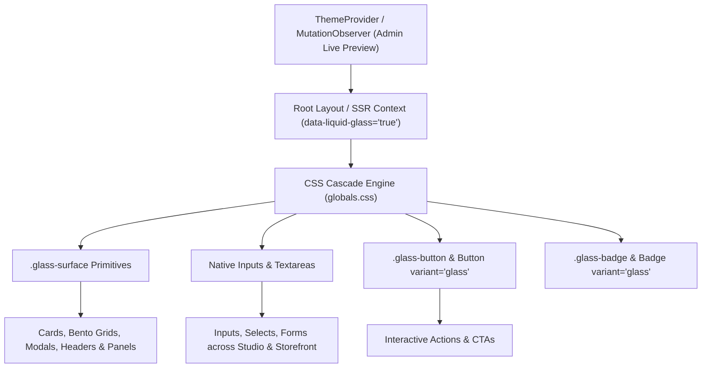

# Liquid Glass & CSS Data-Attribute Cascade Architecture

Specification of Artpack's zero-runtime Liquid Glass theme architecture and declarative CSS variable cascade system, replacing client-side hook evaluation with high-performance CSS data-attributes and surface tokens.

---

## 1. Architectural Overview & Design Motivation

Previously, dynamic styling for the "Liquid Glass" theme required leaf components to consume client-side React hooks (`useLiveTheme()`) and inject runtime ternary expressions into className strings. This pattern introduced several architectural issues:

1. **Server Component Incompatibility**: Forcing leaf components (e.g. `Input`, `Textarea`, `ThemedLink`, `Card`) to be Client Components (`'use client'`).
2. **Client Render Overhead**: Subscribing every individual UI primitive to React theme state triggers unnecessary component re-renders.
3. **Styling Inconsistencies**: Ad-hoc inline class combinations led to visual drift across various features and panels.

### The Declarative Cascade Solution

Liquid Glass styling is now controlled declaratively via CSS attributes: `[data-liquid-glass="true"]` attached to the root document (`<html>`) or scoped parent containers. Leaf components simply apply semantic class primitives (such as `.glass-surface`, `.glass-button`, `.glass-badge`, or native form tags) and inherit the glass elevation, backdrop blur, border lighting, and shimmer effects automatically.



---

## 2. CSS Token & Cascade Specification (`globals.css`)

### CSS Variable Definition

When `data-liquid-glass="true"` is active, the theme injects customized glass tokens into `:root` and `.dark`:

```css
:root[data-liquid-glass="true"] {
  --glass-bg: rgba(255, 255, 255, 0.45);
  --glass-border: rgba(255, 255, 255, 0.4);
  --glass-blur: 24px;
  --glass-shadow: 0 8px 32px 0 rgba(31, 38, 135, 0.08);
  --glass-shimmer-opacity: 0.15;
}

.dark[data-liquid-glass="true"] {
  --glass-bg: rgba(15, 23, 42, 0.45);
  --glass-border: rgba(255, 255, 255, 0.12);
  --glass-blur: 24px;
  --glass-shadow: 0 8px 32px 0 rgba(0, 0, 0, 0.37);
  --glass-shimmer-opacity: 0.08;
}
```

### Automatic Surface Overrides

Any element marked with `.glass-surface`, `[data-surface="glass"]`, or `.liquid-glass-card` receives hardware-accelerated backdrop filters and reactive shimmer animations:

```css
[data-liquid-glass="true"] .glass-surface,
[data-liquid-glass="true"] [data-surface="glass"],
[data-liquid-glass="true"] .liquid-glass-card {
  background-color: var(--glass-bg) !important;
  border-color: var(--glass-border) !important;
  backdrop-filter: blur(var(--glass-blur)) saturate(180%) !important;
  -webkit-backdrop-filter: blur(var(--glass-blur)) saturate(180%) !important;
  box-shadow: var(--glass-shadow), inset 0 1px 1px 0 rgba(255, 255, 255, 0.2) !important;
}

[data-liquid-glass="true"] input:not([type="checkbox"]):not([type="radio"]):not([type="submit"]):not([type="button"]):not([type="reset"]),
[data-liquid-glass="true"] textarea,
[data-liquid-glass="true"] select {
  background-color: var(--glass-bg) !important;
  border-color: var(--glass-border) !important;
  backdrop-filter: blur(12px) saturate(150%) !important;
  -webkit-backdrop-filter: blur(12px) saturate(150%) !important;
  box-shadow: 0 2px 8px 0 rgba(0, 0, 0, 0.04), inset 0 1px 1px 0 rgba(255, 255, 255, 0.15) !important;
}
```

---

## 3. Component Architecture & Standardized Usage

### 3.1 Common Input & Textarea (`src/components/ui/input.tsx`, `textarea.tsx`)
Inputs no longer require client hooks. Standard form controls automatically adapt to the active theme cascade:

```tsx
import { Input } from '@/components/ui/input'

// Renders glass-styled with prefix in Liquid Glass mode, or standard theme styling otherwise
<Input
  prefix={<span className="text-muted-foreground">$</span>}
  placeholder="0.00"
  value={amount}
  onChange={(e) => setAmount(e.target.value)}
/>
```

### 3.2 Standardized Button (`src/components/ui/button.tsx`)
Offers a first-class `glass` variant and `.glass-button` class support:

```tsx
import { Button } from '@/components/ui/button'

<Button variant="glass" size="lg">
  Explore Collection
</Button>
```

### 3.3 Card & CardBezel (`src/components/ui/Card.tsx`)
Card primitives render `.glass-surface` by default, allowing parent themes to cascade smoothly without passing runtime boolean props:

```tsx
import { Card } from '@/components/ui/Card'

<Card.Bezel>
  <h2 className="text-xl font-bold">Commission Overview</h2>
  <p>Track your project live on the queue.</p>
</Card.Bezel>
```

---

## 4. Summary of Files Refactored

| File / Component | Type | Changes Made |
| :--- | :--- | :--- |
| `src/app/globals.css` | Stylesheet | Added `[data-liquid-glass="true"]` tokens and cascade selectors for `.glass-surface`, inputs, buttons, badges, and cards. |
| `src/components/ui/input.tsx` | UI Primitive | Removed `useLiveTheme` hook; relies on CSS cascade. |
| `src/components/ui/textarea.tsx` | UI Primitive | Removed `useLiveTheme` hook; relies on CSS cascade. |
| `src/components/ui/button.tsx` | UI Primitive | Added `glass` CVA variant and `.glass-button` CSS support. |
| `src/components/ui/badge.tsx` | UI Primitive | Added `glass` CVA variant and `.glass-badge` CSS support. |
| `src/components/ui/ThemedLink.tsx` | UI Primitive | Converted to static `.glass-surface` component. |
| `src/components/ui/Card.tsx` | UI Primitive | Converted `cardClasses` and `CardBezel` to use `.glass-surface`. |
| `src/components/NavHeader.tsx` | Navigation | Replaced JS ternary branches with `.glass-surface` cascade. |
| `src/components/FooterSocials.tsx` | Footer | Converted glitch banner and socials to `.glass-surface`. |
| `src/components/HomeBentoGrid.tsx` | Block | Cleaned up hook references; uses standard `cardClasses`. |
| `src/components/blocks/*` | CMS Blocks | Converted Hero, FAQ, MediaGallery, and SocialLinks to `.glass-surface`. |
| `src/features/dashboard/*` | Feature UI | Converted `CommissionCard`, `ProfileHeader`, `DashboardFilters`, and `DashboardNav` to `.glass-surface`. |
| `src/features/queue/*` | Feature UI | Converted `KanbanCard`, `SortableColumn`, `CommissionStatusToggle`, and `RoadmapSection` to `.glass-surface`. |
| `src/features/pricing/*` | Feature UI | Converted `HeroLayout` (formerly `CharacterDrawingTiers`), `PriceList`, and `ApplySlotButton` to `.glass-surface`. |
| `src/features/commissions/*` | Feature UI | Converted `Mascot`, `FileUpload`, `ProjectTierSelector`, `ArtistReviewForm`, `CommissionSidebar`, and `VerifiedQuoteView` to `.glass-surface`. |
| `src/features/shop/*` | Feature UI | Converted `ShopItem`, `ProductSidebar`, and `ProductImageGallery` to `.glass-surface`. |

---

## 5. Verification & Testing Reference

1. **TypeScript Validation**:
   ```bash
   npx tsc --noEmit
   ```
   *Expected output: Process finishes with 0 errors.*

2. **Integration Tests**:
   ```bash
   npm run test:int
   ```
   *Verifies database schema operations, API endpoints, and Local API interactions.*

3. **End-to-End Tests**:
   ```bash
   npm run test:e2e -- tests/e2e/auth.e2e.spec.ts
   ```
   *Validates registration, verification emails, login, and dashboard navigation.*
