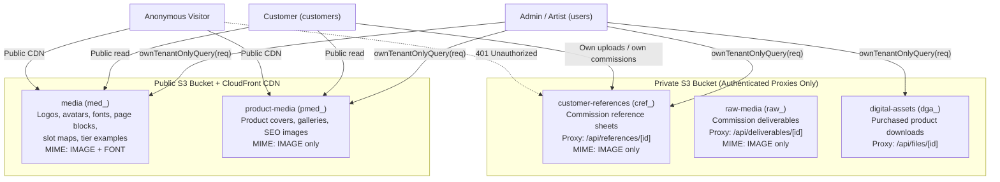

# Media Collections Separation & Multi-Tenant Isolation

Architectural specification for splitting the previously overloaded `media` collection into domain-scoped, tenant-isolated collections (`media`, `product-media`, `customer-references`) with private S3 storage and authenticated streaming for customer commission reference sheets.

---

## 1. Problem & Motivation

Previously, all non-download/non-deliverable uploads lived in a single `media` collection with `access.read: () => true`:

1. **Cross-tenant leakage in admin pickers**: Because `Media.access.read` returned `true` unconditionally, opening any media picker (e.g. `Products → Images`) returned media from *every* studio on the platform. Similarly, `DigitalAssets.access.read` bypassed `ownTenantOnlyQuery(req)` for platform admins even when scoped to a studio via `TenantSelector`.
2. **Mixed public & private assets**: Customer-uploaded commission reference sheets (`Commissions.referenceImages`) lived in the public S3 bucket / CloudFront CDN alongside studio logos, product covers, and custom font files (`.woff2`/`.ttf`/`.otf`).
3. **Cache & MIME pollution**: `Media` had to allow font MIME types for `Themes.customFontFile`, and `revalidateMediaCache` had to special-case skipping customer-owned uploads to avoid stampeding studio caches on every commission submission.

---

## 2. Architecture Overview

### Collection Contracts

| Collection | Slug | ID Prefix | S3 Bucket | URL / Delivery | Read Access | Cache Revalidation |
| :--- | :--- | :--- | :--- | :--- | :--- | :--- |
| **Studio Media** | `media` | `med_` | Public (`NEXT_PUBLIC_S3_BUCKET`) | CloudFront CDN (`getCdnUrl`) | Guests/customers: `true`; `users`: `ownTenantOnlyQuery(req)` | Pages, products, studio meta, platform discovery |
| **Product Media** | `product-media` | `pmed_` | Public (`NEXT_PUBLIC_S3_BUCKET`) | CloudFront CDN (`getCdnUrl`) | Guests/customers: `true`; `users`: `ownTenantOnlyQuery(req)` | Products + platform discovery (`revalidateProductMediaCache`) |
| **Customer References** | `customer-references` | `cref_` | Private (`S3_PRIVATE_BUCKET`) | Authenticated proxy `/api/references/[id]` (`Cache-Control: private`) | Guests: `false`; `users`: `ownTenantOnlyQuery(req)`; `customers`: own uploads (`ownTenantOrCustomer('owner')`) | None (never rendered on public storefront pages) |
| **Digital Assets** | `digital-assets` | `dga_` | Private (`S3_PRIVATE_BUCKET`) | Authenticated proxy `/api/files/[id]` | `users`: `ownTenantOnlyQuery(req)`; `customers`: verified purchase (`getCachedAssetAccess`) | None |

---

## 3. Key Implementation Details

### 3.1 Private Customer Reference Proxy (`/api/references/[id]`)

- Route handler: `src/app/api/references/[id]/route.ts`
- Rate-limited via `apiRateLimiter` (`reference_${ip}`).
- Unauthenticated requests always receive `401 Unauthorized`.
- Authorization lives in `src/features/media/lib/reference-access.ts` (`resolveReferenceAccess`):
  1. `users` (studio artists & platform admins): authorized via `userHasTenantAccess(user, reference.tenant)`.
  2. `customers`: authorized if they are the `owner` (`owner.relationTo === 'customers'` matching `user.id`) **or** own a commission whose `referenceImages` contains `docId`.
  3. Everyone else receives `403 Forbidden`.
- Streaming lives in `src/features/media/lib/reference-stream.ts` (`streamCustomerReference`):
  - Streams directly from S3 with `Cache-Control: private, max-age=3600` (never mints a presigned GET URL).
  - Supports HTTP `Range` headers and local fallback redirect when S3 is unconfigured.

### 3.2 Legacy S3 Key Compatibility (Zero-Downtime Migration)

Existing product images and commission reference sheets uploaded prior to the split live in the public S3 bucket under `{env}/media/tenants/{studioId}/{filename}`.

- Postgres migration `20261125_180000_split_product_media_and_customer_references` copies those rows into `product_media` and `customer_references` with their original IDs and normalizes their `prefix` to an explicit `media/...` path (e.g. `media/tenants/{studioId}` or `media`).
- `getS3Key` and `isLegacyPublicMediaPrefix` in `src/lib/utils/cdn.ts` recognize explicit `media` / `media/...` / `dev/media/...` / `test/media/...` prefixes and resolve them to the original object key instead of prepending `product-media/` or `customer-references/`.
- `resolveReferenceStorageBucket` in `src/features/media/lib/reference-stream.ts` reads migrated `customer-references` rows from `getPublicS3Bucket()` (still gated by `/api/references/[id]` auth) and new uploads from `getPrivateS3Bucket()`.

### 3.3 AI Estimation & Presigned Uploads

- **Presigned PUTs** (`src/app/api/media/presigned-url/route.ts`): Authenticated customers and artists may target `collection: 'customer-references'` (routed to `S3_PRIVATE_BUCKET`), and artists/admins may target `product-media` or `raw-media`.
- **Commission submission** (`src/features/commissions/services/commission.service.ts`, `src/features/commissions/lib/submission-media.ts`): Uploads to `customer-references`, validates tenant-scoped keys (accepting canonical `customer-references/tenants/{studioId}/{file}` plus legacy `media/tenants/{studioId}/{file}` during rollout), performs S3 `HeadObject` against the resolved bucket, and persists records via `createCustomerReference`.
- **AI pricing estimation** (`src/lib/ai/estimateCommission.ts`): Loads references via `getCustomerReferenceById` and reads bytes directly from local disk or S3 (`getS3ObjectWithKeyFallback`) rather than making an unauthenticated HTTP request to `/api/references/[id]`.

### 3.4 Product Write Validation & Relationship Scoping

- `Products.images` and `Products.meta.image` relate to `product-media` with `filterOptions: filterProductTenantOptions`.
- `requireAtLeastOneImage` and `requireAtLeastOneFile` in `src/collections/Products.ts` delegate to Payload's built-in `relationship` validator (`payload/shared`) whenever `options?.req?.payload` is present, ensuring `filterOptions` is enforced on every write (REST and Local API), not only in the admin picker.
- `Products.bundleProducts` filters to the same tenant and excludes the product itself (`filterBundleProductOptions`).

---

## 4. Files Changed

### Collections, Hooks & Access Control
- `src/collections/ProductMedia.ts` — new `product-media` collection (`pmed_`)
- `src/collections/CustomerReferences.ts` — new private `customer-references` collection (`cref_`)
- `src/collections/Media.ts` — tenant-scoped `access.read` via `ownTenantOnlyQuery(req)`; uses shared `rescueUploadMetadata`
- `src/collections/DigitalAssets.ts` — routes admins through `ownTenantOnlyQuery(req)` so `TenantSelector` scopes downloads
- `src/collections/Products.ts` — points `images` / `meta.image` to `product-media`, adds tenant `filterOptions` & built-in relationship validation delegation
- `src/collections/Commissions.ts` — points `referenceImages` to `customer-references`
- `src/collections/hooks/rescueUploadMetadata.ts` — extracted shared client-upload extension/MIME rescue hook
- `src/collections/hooks/revalidateProductMediaCache.ts` — product + discovery cache invalidation hook
- `src/collections/hooks/syncProductToStripe.ts` — resolves artwork via `getProductMediaById`
- `src/access/ownTenantOnly.ts` — handles both Web `Headers` and plain header objects in `ownTenantOnlyQuery`
- `src/payload.config.ts` & `src/plugins.ts` — registers collections and public/private S3 bucket mappings

### Media Feature, Proxy, Storage & Infrastructure
- `src/app/api/references/[id]/route.ts` — authenticated private proxy for `customer-references`
- `src/app/api/media/presigned-url/route.ts` — allows `customer-references` (private bucket) & `product-media` (public bucket)
- `src/features/media/actions/product-media.action.ts` — `getProductMediaById`, `createProductMedia`, `deleteProductMedia`
- `src/features/media/actions/customer-reference.action.ts` — `getCustomerReferenceById`, `createCustomerReference`, `deleteCustomerReference`
- `src/features/media/lib/reference-access.ts` — authorization rules for `/api/references/[id]`
- `src/features/media/lib/reference-stream.ts` — bucket resolution and private S3 streaming
- `src/features/media/server.ts` & `src/features/media/services/media.service.ts` — barrel exports and collection-aware presigned URL client
- `src/features/commissions/services/commission.service.ts` & `src/features/commissions/lib/submission-media.ts` — customer reference upload & ingestion
- `src/lib/ai/estimateCommission.ts` — direct S3/disk buffer reading for private references
- `src/lib/utils/cdn.ts`, `src/lib/utils/id.ts`, `src/lib/utils/admin-ia.ts`, `src/lib/tenant/tenant-payload.ts` — S3 private registry, legacy key preservation, prefixes, admin IA, tenant scoping
- `src/lib/infra/cleanup-plan.ts` & `src/lib/infra/cleanup.ts` — deep account cleanup for `product_media` and `customer_references`

### Migrations, Seeds & Scripts
- `src/migrations/20261125_180000_split_product_media_and_customer_references.ts` & `src/migrations/index.ts` — schema + data migration preserving existing S3 keys
- `src/app/(frontend)/api/seed/route.ts`, `src/seedGlobals.ts`, `tests/helpers/seedProduct.ts` — updated seed fixtures
- `scripts/migrate-ronya-to-artpack.ts` — updated Ronya import to route product images to `product_media` (public S3) and commission references to `customer_references` (private S3)

### Tests
- `tests/int/media-tenant-isolation.int.spec.ts` — unit tests for access control, `filterOptions`, legacy S3 keys, bucket routing, and `/api/references/[id]` authorization
- `tests/int/shop-multi-tenant-media.int.spec.ts` — DB integration tests for `product-media` / `customer-references` isolation and cross-tenant write rejection
- Updated existing specs (`submission-media`, `cleanup-plan`, `s3-buckets`, `product-completeness`, `products-by-ids`, `product-net-pricing`, `order-customer-names`, `library-orders-fresh`, `refund-flow`, `platform-fee-persistence`, `dashboard-stats`, `ai-estimate-fail-open-db`, `round-slot-accounting-db`, `review-moderation-db`, `review-queue-db`, `toggle-commissions-db`, `customer-close-slot-db`, `notification-redirect`)

---

## 5. Debug Reference

- **Symptom: Migrated product image or customer reference returns 404 from S3**
  - Inspect `prefix` on the row in `product_media` / `customer_references`: migrated pre-split rows must carry `media` or `media/tenants/<studioId>` (not bare `tenants/<studioId>`, which resolves under `product-media/` or `customer-references/`).
  - Verify `isLegacyPublicMediaPrefix(row.prefix)` returns `true` and that `NEXT_PUBLIC_S3_BUCKET` is configured.
- **Symptom: `/api/references/[id]` returns `401` or `403`**
  - Anonymous callers always get `401`.
  - Customers must either match `owner = { relationTo: 'customers', value: user.id }` or own a commission whose `commissions_rels` (`path = 'referenceImages'`) contains `customer_references_id = id`.
  - Artists must belong to the reference's `tenant` (`userHasTenantAccess`).
- **Symptom: AI estimate skips reference images**
  - Verify `S3_PRIVATE_BUCKET` (for new uploads) or `NEXT_PUBLIC_S3_BUCKET` (for migrated rows) and `S3_ACCESS_KEY_ID` / `S3_SECRET_ACCESS_KEY` are set; `estimateCommission` never calls `/api/references/[id]` over HTTP.
- **Symptom: Cross-tenant images appear in admin picker**
  - Confirm the browser holds `payload-tenant-context=<studioId>` (set by `TenantSelector`). For admins without that cookie, `ownTenantOnlyQuery` intentionally returns `true` (all studios); selecting a studio in the header switcher scopes every media collection immediately.
