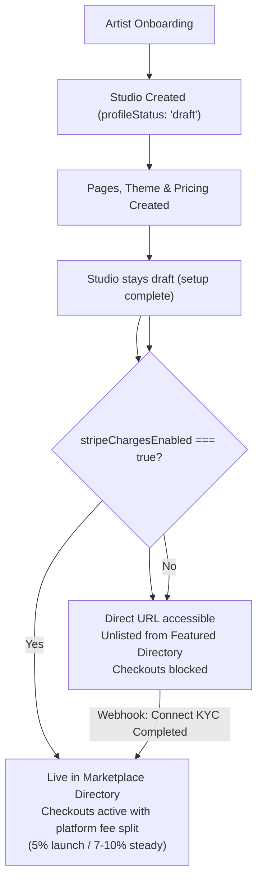

# Monetization Model, Listing Gates & Stripe Connect Requirement (SPEC)

> **Status**: APPROVED ARCHITECTURE — simplified decision aligned with platform business model.
> **Related**: `docs/stripe-connect-destination-charges.md` (payment rail), `docs/guided-studio-setup-tour.md` (setup tour whose last step is monetization/publishing).

## Overview

ArtPack is a transactional creator platform (AI pricing, automated queue progression upon payment, instant digital shop fulfillment, split payouts, buyer protection). 

Because the entire platform lifecycle relies on automated payment settlement, **Stripe Connect is the mandatory payment rail**. If a studio has not connected Stripe, it cannot accept payments or sell products. 

This spec establishes:
1. **Listing readiness** — studios are hidden from public promotion while in draft/setup mode.
2. **Hard payment gate** — checkouts (commissions, digital shop, tips) require active Stripe payouts (`stripeChargesEnabled === true`); unconfigured studios cannot initiate paid checkouts.
3. **Directory listing gate** — platform discovery (Featured studios) strictly features fully configured, monetizable studios (`profileStatus === 'published' AND stripeChargesEnabled === true`).
4. **Monetization alignment** — platform earns through the platform fee split on transactions (5% launch year, 7-10% steady state; waived studios always cover Stripe's processing floor, so the platform balance can never go negative). No half-functional subscription substitutes for Stripe Connect.

---

## Verified Current State

- `getFeaturedStudios` (`src/features/studios/actions/get-studio.action.ts`): Previously retrieved studios with no readiness or Stripe filter.
- `Studios` collection (`src/collections/Studios.ts`): Has `stripeAccountId, stripeChargesEnabled, stripePayoutsEnabled, stripeDetailsSubmitted` synced in real-time via Stripe webhooks (`src/lib/stripe/stripeWebhooks.ts`), with cache invalidation on changes (`src/collections/hooks/revalidateStudioCache.ts`).
- Payment rail: Stripe Connect Express destination charges + platform split fee (`calculatePlatformFee`), see `docs/stripe-connect-destination-charges.md`.
- System pages: Created at the end of onboarding (`artist-onboarding.action.ts`) via `createDefaultPagesForTenant`.

---

## Part 1 — Listing Readiness: `profileStatus` Flag

To prevent incomplete studios from showing on platform surfaces:

1. Add `profileStatus` to `Studios`: `select` of `'draft' | 'published'`, **default `'draft'`**.
2. `profileStatus` is **derived, not authored**: onboarding leaves the studio in `draft`, and `syncStudioStripeStatus` (called by the `account.updated` webhook and the payouts-status poll route) sets `'published'` the moment Stripe reports `charges_enabled`, returning it to `'draft'` if charging stops. The rule lives in `src/features/studios/lib/profile-status.ts`.
3. `profileStatus` is **not hand-editable**: it mirrors Stripe, and both writers (`account.updated` webhook, payouts-status poll route) rewrite it on every sync, so any manual value would survive only until the next Stripe event. The field is therefore `admin.readOnly` in the panel — publication is an outcome of connecting Stripe, not a checkbox. To take a studio offline deliberately, change its Stripe account state (or hide the page); note the field is never consulted when rendering a storefront, only by `getFeaturedStudios`.
4. Seeds (`/api/seed`) explicitly set `profileStatus: 'published'` and `stripeChargesEnabled: true`.

---

## Part 2 — Hard Payment Gate vs. Listing Gate

Two distinct gates are enforced:

| Gate | Rule | Behavior & Rationale |
|---|---|---|
| **Payment Gate** *(Hard technical gate)* | `stripeChargesEnabled === true` required for checkout. | If Stripe is not connected, commission checkout, digital shop purchases, and tips fail closed with a clear error: *"This studio is not configured to accept payments yet."* This prevents platform-only charges without destination transfers. |
| **Listing Gate** *(Marketplace discovery gate)* | `profileStatus === 'published' AND stripeChargesEnabled === true` required for Featured discovery. | Only live, monetizable studios appear in platform directory / featured listings (`getFeaturedStudios`). Unconnected studios remain accessible via direct link/subdomain for preview/testing but receive no platform discovery promotion. |

---

## Part 3 — Monetization Architecture: Transaction-Aligned

### Why Subscriptions Were Rejected as a Stripe Connect Substitute

1. **Breaks core workflows**: ArtPack is not a static website builder. Commission queues, automated file delivery, and client reviews depend on verified payments.
2. **Prevents dead-end buyer traffic**: Charging an artist a monthly subscription for a storefront where checkout is disabled creates a degraded buyer experience and forces transactions off-platform (leakage).
3. **Reduces operational overhead**: Avoids building and maintaining complex billing state machines, proration, and dunning flows for an inferior product tier.

### Platform Fee Split (Current & Future)

The fee is resolved per studio by `resolveStudioPlatformFee` / `resolveStudioFeeSpec` in `src/lib/stripe/stripe.ts`: `round(amount × rate) + fixed`, floored at a 0.50 EUR minimum and capped at the transaction amount.

- **Launch period (year one) — currently active**: **5% platform commission** (`LAUNCH_PLATFORM_FEE_PERCENT`) on completed commission checkouts, digital shop downloads, and supporter tips, minimum 0.50 EUR.
- **Steady state (after the launch year)**: **7-10% platform commission** (`STEADY_PLATFORM_FEE_PERCENT` — currently set to 10%, final number pending), minimum 0.50 EUR. Flip `PLATFORM_FEE_PERIOD` to `'steady'` in `src/lib/stripe/stripe.ts` to switch.
- **Waived studios** (`waivePlatformFees` — platform owner / co-founders): no commission in any period; the **processing-cost floor** (`PROCESSING_FLOOR_RATE` = 3.5% + 0.30 EUR) still applies so card costs are always covered — the floor sits above Stripe's worst-case card pricing (published international cards 3.25% + 0.25 EUR; measured on this account 2026-10-14 at ~3.15% + 0.25 EUR). An explicit `platformFeePercent: 0` behaves the same way.
- **Custom tiers** (`platformFeePercent`, 1-100, admin-only): the custom rate replaces the commission; the 0.50 EUR minimum still applies.

Why the floor exists: with destination charges the platform pays Stripe's processing fee from its own balance (`fees_collector: 'application'`), so any collected fee below Stripe's actual cost would run the balance negative — see `docs/stripe-connect-destination-charges.md`.

- **Future Add-on Subscriptions (Optional Pro Tier)**: Subscriptions may be introduced in the future **on top of** Stripe Connect (e.g., *ArtPack Pro*: 0% platform fee, custom domain routing, priority support), but will never replace the Stripe Connect requirement for transacting.

---

## Lifecycle Flow

---

## Files Changed

- `src/collections/Studios.ts` — Added `profileStatus` field.
- `src/features/onboarding/actions/artist-onboarding.action.ts` — leaves the studio in `draft` after system pages creation (publication is an outcome of connecting Stripe).
- `src/features/studios/lib/profile-status.ts` — the pure publication rule (`resolveProfileStatus`).
- `src/features/studios/actions/sync-stripe-status.action.ts` — the single write path for Stripe fields + derived status, used by the webhook and the poll route.
- `src/features/studios/actions/get-studio.action.ts` — Filter `getFeaturedStudios` by `profileStatus === 'published'` and `stripeChargesEnabled === true`.
- `src/app/(frontend)/api/seed/route.ts` — Set `profileStatus: 'published'` and `stripeChargesEnabled: true` for seeded studios.
- `src/features/commissions/actions/create-commission-checkout.action.ts` — Fail checkout if `stripeChargesEnabled` is false.
- `src/features/shop/actions/create-shop-checkout.action.ts` — Fail checkout if `stripeChargesEnabled` is false.
- `src/features/tipping/actions/create-tip-checkout.action.ts` — Fail checkout if `stripeChargesEnabled` is false.
