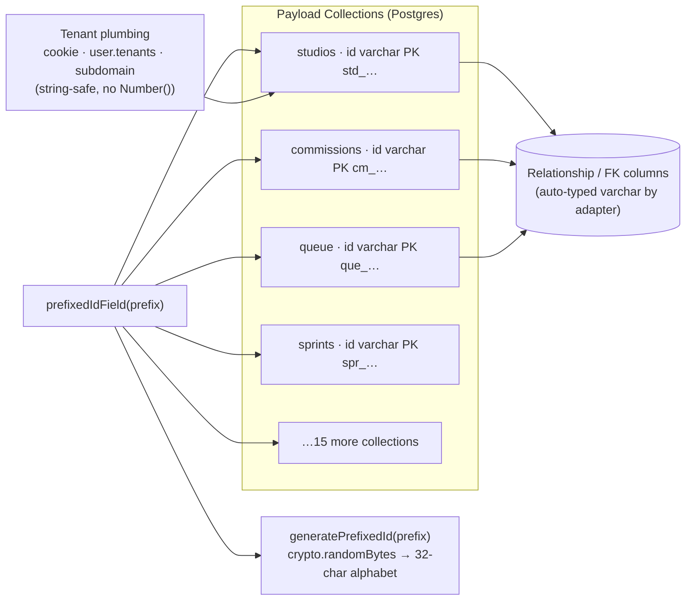

# Prefixed ID Architecture — Stripe-Style Type-Prefixed Primary Keys

## Overview

Every domain collection now uses an opaque, type-prefixed text primary key instead of a sequential PostgreSQL `serial` integer. IDs look like `std_ghe6gbcbq95zygxc` (studio), `cm_j387mwr24s441pn8` (commission), or `que_5vh3hqrpadcdhmzd` (queue item). The change closes the IDOR/predictability surface (order/volume can no longer be guessed by crawling IDs), eliminates cross-environment seed collisions, and makes logs, URLs, webhooks, and Stripe metadata self-describing.

This replaces the previous approach where `Commissions` carried a secondary `guid` field (`cm_${crypto.randomUUID()}`) that was barely consumed — the serial `id` still leaked through Stripe checkout URLs, success/cancel redirects, and metadata.

## Architecture

- **Primary key** is the public identifier. No dual `id` + `guid` pair to drift out of sync.
- **`id` is generated server-side** in `beforeValidate` (falls back to `defaultValue`); clients never supply it. Provided values are preserved so seeds/tests can inject deterministic ids if needed.
- **Relationships and `_rels` join tables** store the varchar value automatically — Payload's postgres adapter types FK columns after the referenced PK. Internal Payload tables (`*_rels`, `payload_kv`, `payload_preferences`, …) keep `serial` ids; those are not publicly addressable.

## ID Prefixes

| Prefix | Collection | Example |
|---|---|---|
| `std_` | studios | `std_8f9x2aq71c3d4e5f` |
| `art_` | artists | `art_…` |
| `usr_` | users | `usr_…` |
| `cus_` | customers | `cus_…` |
| `thm_` | themes | `thm_…` |
| `ntf_` | notification-settings | `ntf_…` |
| `cms_` | commission-settings | `cms_…` |
| `cm_` | commissions | `cm_…` |
| `que_` | queue | `que_…` |
| `qcm_` | queue-comments | `qcm_…` |
| `spr_` | sprints (commission rounds) | `spr_…` |
| `pag_` | pages | `pag_…` |
| `ord_` | orders | `ord_…` |
| `tip_` | tips | `tip_…` |
| `prd_` | products | `prd_…` |
| `dga_` | digital-assets | `dga_…` |
| `med_` | media | `med_…` |
| `raw_` | raw-media | `raw_…` |
| `ann_` | announcements | `ann_…` |

Prefixes live in `ID_PREFIXES` in `src/lib/utils/id.ts`. Generation uses `crypto.randomBytes` mapped onto a 32-char alphabet (`0123456789abcdefghjkmnpqrstvwxyz` — no `i/l/o/u`), length 16 → 20–21 chars total. No `nanoid` dependency; 256 % 32 === 0 so the modulo mapping is unbiased.

## Implementation Details

### 1. ID core (`src/lib/utils/id.ts`)

- `generatePrefixedId(prefix, length?)` — crypto-based generator.
- `prefixedIdField(prefix)` — Payload field factory returning `{ name: 'id', type: 'text', required, unique, index, defaultValue, beforeValidate hook, admin.readOnly }`.
- Each collection declares the factory as its **first field**; `payload.config.ts` keeps the global `idType: 'serial'` — new collections opt in per-collection.

### 2. Removed the legacy `guid` field

- `Commissions.guid` deleted; `getCommissionByGuid` (dead code) deleted; `guid:` payloads removed from `submit-commission/route.ts` and `seedGlobals.ts`. The `cm_` PK is the single identifier now.

### 3. Coercion sweep (the real work — not the DDL)

~86 mechanical sites replaced across the repo:

- `typeof x === 'string' ? parseInt(x, 10) : x` → `x`
- `typeof x === 'string' && !isNaN(Number(x)) ? Number(x) : x` → `x`

Hand-fixed runtime hazards (these would silently produce `NaN` lookups or broken behavior after the switch):

- **Stripe webhooks** (`src/lib/stripe/stripeWebhooks.ts`): metadata ids (`commissionId`, `productId`, `userId`, `tipId`) are now used as strings.
- **Checkout action** (`create-commission-checkout.action.ts`): no more `parseInt` on `commissionId`.
- **Round actions** (`open/close/complete/update/delete-round.action.ts`): id validation simplified to truthiness.
- **`src/lib/infra/cleanup.ts`**: raw SQL interpolations are quoted (`'${id}'`) and string-typed; media id sets are `Set<string>`.
- **`src/lib/cache.ts`**: pricing example-image resolution handles string media ids.
- **`src/app/api/submit-commission/route.ts`**: `customer`/`owner.value` no longer `Number()`-coerced.
- **Studio dispatcher** (`get-studio.action.ts`): `getStudio(idOrSubdomain)` routes `std_…`-prefixed values (or numbers) to `findByID`; anything without the `xx_` shape is treated as a subdomain. Subdomains never contain underscores, so the shape test is unambiguous.
- **Admin header id checks** (`AdminHeaderActions`, `CustomAdminHeader`): numeric `> 0` guards removed.

### 4. Tenant plumbing is string-safe end to end

- `resolveAllowedTenants` / `resolveDocTenantId` (`src/access/ownTenantOnly.ts`) now return `string[]` / `string`.
- `resolveTenant` (`src/lib/tenant/tenant.ts`) returns `string | null`; the `payload-tenant-context` cookie branch compares strings against the user's assigned tenants.
- `ownTenantOnlyQuery` no longer requires the cookie value to be numeric (the tenant switcher would have silently broken otherwise).
- `resolveActiveTenantId` / `resolveTenantIdForRedirect` (`src/features/admin-navigation`) accept string cookie values.
- `dashboard-guard.ts` already compared by string; only its upstream helpers changed.

### 5. Schema & migrations

- Old serial-id migration history deleted (`src/migrations`, 55 files — preserved in git history).
- Fresh baseline generated from the new config: `src/migrations/20260828_104028.{ts,json}`.
- Local DB was dropped (`DROP SCHEMA public CASCADE`) and reseeded with `npm run seed`. Verified live: all collection `id` columns are `character varying`, seeded rows carry prefixed ids.

## Files Changed

- **New**: `src/lib/utils/id.ts`, `src/migrations/20260828_104028.{ts,json}`, `scripts/db-drop.cjs`
- **Collections (19)**: `Announcements, Artists, CommissionSettings, Commissions, Customers, DigitalAssets, Media, NotificationSettings, Orders, Pages, Products, Queue, QueueComments, RawMedia, Sprints, Studios, Themes, Tips, Users` — each declares `prefixedIdField(...)` first.
- **Tenant/access**: `src/access/ownTenantOnly.ts`, `src/lib/tenant/tenant.ts`, `src/features/admin-navigation/actions/{resolve-tenant-redirect,get-direct-nav-links}.action.ts`
- **Runtime fixes**: `src/lib/{stripeWebhooks,cleanup,cache,createDefaultPages}.ts`, `src/app/api/submit-commission/route.ts`, `src/features/**/actions/*` (~50 files), admin components, `src/components/admin/{AdminHeaderActions,CustomAdminHeader,CommissionSettingsAdminView,NotificationSettingsRedirectView}.tsx`, `src/features/studio-settings/components/PayoutsView.tsx`, dashboard course viewer
- **Regenerated**: `src/payload-types.ts`, `src/payload-generated-schema.ts`

## Debug Reference

- **`NaN` lookups / "Invalid id"**: any leftover `Number(id)`/`parseInt(id)` on a prefixed string yields `NaN`. Grep `parseInt(` and `Number(` in `src/` — legitimate uses that remain are page-number parsing, color math, and price parsing only.
- **Tenant switcher ignored**: cookie gates that require `!isNaN(Number(cookie))` will reject prefixed ids. All known gates were removed — if a new one appears, compare strings.
- **Raw SQL in `cleanup.ts`**: ids must be single-quoted in `sql.raw` templates; `mediaIdsToKeep` is `Set<string>`.
- **Studio by id vs subdomain**: pass `std_…` ids to `getStudio()`; anything else is treated as a subdomain handle.
- **Migrations**: with `src/migrations` populated, Payload's `push` is disabled — schema changes go through `payload migrate:create` + `payload migrate`. After a hard local reset, re-run `scripts/db-drop.cjs`, regenerate the baseline if needed, then `npm run seed`.
- **Stale dev server**: Next dev hot-reloads pages but not the Payload config/DB connection. After any schema or DB change, restart `npm run dev`.
- **e2e**: Playwright needs `TEST_DATABASE_URL` in `.env` (currently unset — e2e not runnable locally).
- **Shorter IDs**: change `ID_LENGTH` in `src/lib/utils/id.ts` (e.g. 12 → 16-char ids).

## Known Limitations / Follow-ups

- Internal Payload tables (`*_rels`, `payload_*`) remain `serial` — Payload-managed, not publicly addressable.
- Seeds are idempotent via unique business fields; explicit deterministic ids are supported by the `beforeValidate` hook (value-preserving) but currently unused.
- Production migration path (if data ever exists): re-generate a migration from the serial baseline and backfill relationship columns — deliberately skipped since the project is local-only for now.
