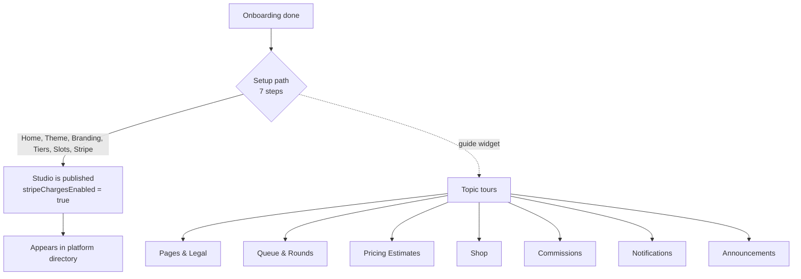

# Setup Tour Content Plan — Artist Guides, Setup Path & Topic Tours

> **Status**: PLAN (decisions locked, not yet implemented)
> **Related**: `docs/guided-studio-setup-tour.md` (runner framework + static guidance layer), `docs/admin-ux-information-architecture-and-dashboard.md` (nav taxonomy the copy reuses), `docs/monetization-listing-gates-and-subscriptions.md` (Stripe gates), `docs/guided-studio-setup-tour.md` (system pages guidance).

## Overview

The tour runner, spotlight mechanic, and card UI already exist (`src/components/admin/tour/`, `src/lib/setup-tour.ts`). What is missing is **content**: guides for Theme, Branding, Commission Settings (slots / rounds / pricing rules), Notifications, Payouts, Commissions, Products and Announcements.

This plan defines:

1. A **copy contract** — the card is a fixed shape, so the text has a fixed shape too.
2. A **curriculum** — a linear *Setup path* (must-do, keeps meaningful progress) plus optional *Topic tours* (per-area, launched on demand).
3. An **anchor registry** — every step needs a `data-guide-target` to point its spotlight at; 15 are missing today.
4. **Runner extensions** — sub-steps, doc-ID resolution, soft save-gating, four-corner card placement.
5. A **Stripe coupling change** so "published" genuinely means "can take money".

## Verified ground truth (2026-09-15)

Checked directly against the code on `guide-tour`:

- **8 steps** exist in `SETUP_TOUR_STEPS` (not the 7 the docs claim): welcome, home hero, pricing tiers, prices FAQ, queue checklist, legal terms, Stripe payouts, publish.
- **Only 4 `data-guide-target` anchors exist**: `pages-list`, `pricing-tiers`, `workflow-checklist`, `stripe-connect`.
- **Step 8's anchor does not exist.** It targets `[data-guide-target="publish-studio"]` and `.custom-admin-header-live-btn`; the real class on the live-site link is `admin-header-live-btn` (`src/components/admin/header/AdminLiveSiteButton.tsx`). Step 8 currently shows a card with no spotlight.
- **`isSaveGated` is dead config.** It is declared on `SetupTourStep` and set on 5 steps, but no component reads it. There is no save detection anywhere in the tour. The claim in `docs/guided-studio-setup-tour.md` that save-gated dialogs are implemented is inaccurate.
- **Sub-steps exist only for the home hero**, hardcoded in `useHomeHeroSubStep.ts` (5 sub-steps, driven by route match, `data-live-preview-active`, and DOM presence).
- **The scrim is non-blocking.** `TourSpotlight` renders with `pointerEvents: 'none'`, so dimming is purely visual — artists click straight through the hole. The guide cannot enforce order; copy must be safe to skip.
- **The spotlight self-blanks when a drawer/modal opens** (`.drawer--is-open`, `[role="dialog"]`, `.payload-modal`). Steps targeting drawer content show a card with no highlight for a moment.
- **No publish control exists** anywhere in the admin UI. `profileStatus` is written only by onboarding (`artist-onboarding.action.ts:347`, unconditionally `'published'`) and the seed route. The Stripe webhook (`stripeWebhooks.ts:398`) updates the three `stripe*` fields and never touches `profileStatus`.
- **Nothing gates storefront rendering on `profileStatus`.** The only consumer is `getFeaturedStudios` (`get-studio.action.ts:233`), which requires `published` **and** `stripeChargesEnabled`. Checkout in commissions/shop/tips fails closed without `stripeChargesEnabled`.
- **Payload 3.88.0** exposes `useFormSubmitted`, `useFormModified`, `useFormProcessing`, `useDocumentInfo` (verified in `node_modules/@payloadcms/ui`) — soft save-gating needs no new infrastructure.

## Locked decisions

- **Branding** means the studio's identity: logo, mobile mark, social links, name/domain.
- **Curriculum** splits into a Setup path + Topic tours (not one long linear tour).
- **Save-gating** is **soft**: it never blocks; a successful save promotes the next step.
- **"Rounds"** is the artist-facing word everywhere (never sprints/work batches).
- **Publish is coupled to Stripe** (option A below): a studio becomes `published` when Stripe reports `charges_enabled`.

## Part A — Copy contract

The card shape is fixed by `TourCardBody.tsx`: title (17px), subtitle (13px), then 2–3 bullet tips (12px) inside a 460px-wide card. Write to that shape:

- **Title** — ≤48 chars, benefit-first, one emoji at the end. A nudge, not a field label. *"Plan a Commission Round 🗓️"*, not *"Sprint Configuration"*.
- **Subtitle** — one sentence answering *"why do I care?"*. Never names an internal concept.
- **Bullets** — max 3, one short sentence each, **≤110 codepoints** (two lines at 12px in the 460px card; longer wraps to a wall of text mid-task).
  1. The physical action, bound to the glow: *"Click the glowing box to open the Rounds panel…"*
  2. The option or detail they would otherwise miss.
  3. What changes for the client, or when they will see it.
- **No action button** — the card carries only Skip / Back / Next. The runner steers the artist to the step's screen by itself (`src/lib/tour-navigation.ts`), so no copy may say *"click the button below"* or otherwise promise a jump control; the steering note is *"the guide opens … for you — no button to click"*.
- **Vocabulary** — "you" / "your studio". Never tenant, entity, collection, document, slug, payload, schema, endpoint, boolean, **AI** — say section, page, tier, round, your price. (`block` is fine: the page builder's own button says "Add Block".) Enforced by the jargon guard in `tests/int/setup-tour-copy.int.spec.ts`.
  - **The product never says "AI".** It says **estimator** (the pricing pre-fill) and **Theme Generator** (the palette/typewriter prompt). This is not a style preference: an artist wants their studio to look like them, and naming a model made the result feel borrowed. The internal names did not change (`ai-guidelines` step id, `cs-ai-guidelines` anchor, `AIThemeGeneratorAdminField`, `pending_ai`), so the copy rule is the only place the two vocabularies meet — and the jargon guard is what keeps them from drifting back.
- **Numbers over vagueness** — "3 at a time", "5000 means $50.00".

Two rules specific to the spotlight UX:

- **Steps are either *do* or *know*, and know-steps must say so.** The glowing box implies obligation; a knowledge step has to state *"Nothing to do here — this is just so you know what you're looking at."* Otherwise artists hunt for a task that doesn't exist.
- **Never write copy that depends on the artist not clicking elsewhere.** The scrim does not block, so a step's target can be navigated away from at any moment. Every step must be resumable and safe to skip.

### Screen budget

A 3-tip card is ~340px tall and sits bottom-right (or bottom-left when `isTargetInBottomRight` fires). With ~30 targets planned, the card will routinely cover the hole it is describing. Fix in Part D.

## Part B — Curriculum

### Setup path (linear, must-do: 7 setup steps + a live outcome)

Ordered so the cheap wins come first, money last, and the tedious content work is not a barrier to going live.

1. **Welcome** — what this does, how to pause (`existing`)
2. **Home Hero** — headline + bio, keeps its 5 sub-steps (`existing`)
3. **Theme & Colors** — *new*, 3 sub-steps (colors → typography → shape/liquid glass)
4. **Branding** — *new*, 2 sub-steps (logo + mobile mark → social links)
5. **Pricing Tiers** — base prices and sample artwork (`existing`)
6. **Slots & Currency** — *new* (max slots, per-customer limit, currency)
7. **Stripe Payouts** — connect Express, what happens during review (`existing`, enriched)
8. **You're live** — outcome step: live-site link, where to share; no publish button (`replaces existing step 8`)

### Topic tours (optional, launched from the widget and a "?" on the screen)

Both entry points are **implemented**. `StudioTourLauncher` lists every tour with per-tour progress (the header widget opens it); `ScreenGuideButton` renders a "?" in the header on any screen that has guides, scoped to just those.

The screen match is **derived from the step config** (`getToursForPath`) rather than a parallel lookup table, so a new step teaches the launcher about its own screen for free. One rule matters: the dashboard root is not a screen — `/admin` is a prefix of every admin route, so `isScreenScopedStep` excludes routes that don't actually name one. Without it, every screen in the panel would claim to have guides. Both are unit-tested, including the trap.

- **Pages & Legal** — system pages overview, Prices page FAQ, legal personalization (`reparented from the old linear steps 4 and 6`)
- **Queue & Rounds** — workflow checklist (`existing`) + Rounds (create → slots and dates → close)
- **Pricing Estimates** — per-type pricing rules, "the estimator suggests, you set the final price"
- **Shop** — product types, price in cents, digital files, bundles
- **Commissions** — the pipeline, knowledge only (list → estimate → your price → deliverables)
- **Notifications** — Discord webhook, the two toggles, optional comments webhook
- **Announcements** — top vs bottom stripe, background color, clearing stale banners

## Part C — Anchor registry

An anchor is whatever CSS selector the spotlight can rely on. There are four mechanisms, because only some surfaces are ours to edit:

1. **Custom components we own** — `data-guide-target="<area>-<element>"`, kebab-case, one area prefix per surface. A step's `targetSelector` lists fallbacks comma-separated (existing behaviour).
2. **Native Payload fields** — `#field-<name>`, generated by Payload's `generateFieldID` (`.` becomes `__`). Named groups (`aiAnalysis`, `artistReview`) put that id on the group **wrapper**; simple fields put it on the **input**. No markup change needed.
3. **Native Payload groups as sections** — `admin.className: 'guide-<area>-<element>'` on a group, which Group/index.js appends to the wrapper's class list. Used for the Theme sections so the glow covers the whole section instead of one control.
4. **Stock Payload chrome** — `.list-create-new-doc__create-new-button` (the Create New button), `.list-controls`, `.collection-list` for list views we do not own.

### Added in the anchor pass

- **Commission Settings** (`CommissionSettingsAdminView.tsx`) — `cs-general`, `cs-rounds`, `cs-ai-guidelines` on the tab buttons **and** on their panels (`GeneralSettingsTab`, `CommissionRoundsPanel`, `AiGuidelinesTab`), mirroring the existing `pricing-tiers` double-anchor so the spotlight survives either state.
- **Commissions list** (`CommissionsListHeader.tsx`) — `commissions-list` on the header card.
- **Payouts** (`IntegrationsTab.tsx`) — `payouts-connect` on the Stripe Connect section. `stripe-connect` stays on the page root as a fallback; step 7 now prefers `payouts-connect`.
- **Theme** (`Themes.ts`) — `guide-theme-colors`, `guide-theme-typography`, `guide-theme-style` via `admin.className`.

### Native ids to use in step configs (no markup change)

- **Theme** — `#field-useLiquidGlass`
- **Branding** (`Studios.ts`) — `#field-logo`, `#field-logoMobile`, `#field-socialLinks`
- **Notifications** — `#field-discordWebhookUrl`, `#field-notifyOnSubmission`
- **Commission detail** — `#field-aiAnalysis`, `#field-artistReview`
- **Products / Announcements lists** — `.list-create-new-doc__create-new-button`, then `.list-controls`, `.collection-list`

Legacy names `pricing-tiers` and `workflow-checklist` stay as-is; new steps reference both spellings as fallbacks rather than forcing a rename.

> **Verification status**: **VERIFIED against a live admin.** `tests/e2e/setup-tour-anchors.e2e.spec.ts` passes 12/12 — every step's primary anchor and every declared sub-step anchor resolves to a visible element, across all 11 admin routes. This includes the `#field-*` ids and `admin.className` group selectors that were originally derived from reading Payload's source rather than observed.

## Part D — Runner extensions

1. **Sub-step engine** — **DEFERRED**, deliberately. The plan was to generalize `useHomeHeroSubStep` into a declarative `subSteps[]`. That is the one item that rewrites *working* behaviour (the home-hero flow is the tour's flagship), and it is not needed until Theme/Branding steps exist to consume it. Doing it blind — no browser, no DB in the build environment — risks breaking the flow that works today, for a capability nothing uses yet. It ships together with the Theme/Branding copy so it is exercised the moment it lands.
2. **Doc-ID resolution** — **DEFERRED** with item 1; it only exists to feed dynamic-ID routes that the same copy wave introduces.
3. **Soft save-gate** — **DONE.** `src/lib/tour-save-gate.ts` holds the rules (pure, unit-tested); `useStepSaveGate.ts` supplies events. **The detection mechanism changed from the plan:** the plan said `useFormSubmitted` / `useFormModified`, but Payload's form context is unreachable from the tour — the runner renders in the admin header, a *sibling* of the document form, not a descendant. The gate therefore watches Payload's save-confirmation toast (`[data-sonner-toast][data-type="success"]`, sonner 1.7.4 behind Payload's `.payload-toast-container`). It never blocks: `nextStep` stays available, the card just promotes the next step and outlines itself green once a save is seen.
4. **Four-corner card placement** — **DONE**, as `src/lib/tour-placement.ts` — a pure `pickCardSide({ target, viewport, card, gutter })` that picks whichever bottom corner overlaps the spotlight hole least, defaulting right and deferring to the responsive styles when the card is full-width. Unit-tested (9 cases) because it is pure.
5. **Per-step skip** — **DONE.** Driven by a new `intent: 'do' | 'know'` field plus `isExternallyGated`. `skipStep()` advances and records the step as *skipped, never completed* — `skippedStepIds` is a separate array, so a skipped step stays pending and can still be finished later. Knowledge and externally gated steps get a dashed "Skip for now"; the Stripe step is marked `isExternallyGated`.
6. **Fix step 8** — **DONE** in the anchor pass (`.admin-header-live-btn`). It becomes the "You're live" outcome step under Part E.
7. **Grouping** — **DONE.** `tourId` on every step plus a `TOURS` registry holding the full curriculum (8 tours; only those with steps are offered). Step numbering is now **derived per tour** rather than stored — `getStepPosition(stepId)` returns `{ stepNumber, totalSteps }` scoped to that tour, so the setup path reads "Step 3 of 5" instead of "Step 3 of 8". Storing a global number was the reason the old config drifted whenever a step moved.
8. **`isSaveGated`** — **IMPLEMENTED**, no longer dead config. Steps marked `isSaveGated` opt into the promotion UI; knowledge steps never gate.
9. **Spotlight clipping** — **DONE** after a scroll bug report. The cutout is drawn in viewport coordinates while the admin pins two sticky headers over the top of the page, and the original code clamped the hole's *top* to the viewport while keeping its full height — which does not cut the cutout, it *slides* it down by the overflow. Scroll the Theme step's 500px `🎨 Colors` group by ~60px and the highlight covered the header (98% of the header band left un-dimmed) *and* grabbed the first rows of the next sub-step's Typography section. The hole is now the intersection of the padded target with the usable band (`src/lib/tour-spotlight.ts`, pure and unit-tested), the band comes from whatever chrome is currently pinned to the top (`resolveVisibilityBand` in `src/lib/tour-dom.ts`), and a target that has left the band produces no cutout at all instead of a sliver.

Items 1–8 are covered by `tests/int/tour-state.int.spec.ts` (transitions, normalization, curriculum grouping, save-gate rules — including that skipping is not completing and that a stale index cannot strand the artist past the end of a shrunken step list) and `tests/int/tour-placement.int.spec.ts`; item 9 by `tests/int/tour-spotlight.int.spec.ts` and `tests/e2e/setup-tour-spotlight.e2e.spec.ts`.

10. **Auto-open & reload model** — **DONE**, as `src/lib/tour-auto-open.ts` (pure, unit-tested). Two rules, both narrow on purpose, because the naive version of each got a real case wrong:
    - **Load** (`patchForLoad`) — only the card the guide opened *by itself* and nobody touched is collapsed on the next load. Interaction is `currentStepIndex > 0 || completedStepIds.length || skippedStepIds.length`, so a tour the artist advanced, skipped through, or reopened from the trigger stays exactly where they left it. Collapsing every stored setup tour was overriding the artist; it also emptied the seed `tests/e2e/setup-tour-spotlight.e2e.spec.ts` uses to point the tour at a step.
    - **Auto-open** (`patchForAutoOpen`) — the guide opens itself once, for a **draft** studio, and only from a studio read that *succeeded*. `publication: 'unknown'` (not read yet, read failed, no studio) returns no decision at all: opening on a guess would pop a wizard at an artist whose studio is finished, and recording `hasAutoOpened` from that guess would burn the one opening they were owed. Published studios never see the wizard, and their *artist-driven* state is left alone (the progress it reports is already "complete").
    - **Publication is derived, never read from the stored flag** — `TourFacts.publication` is `resolveProfileStatus({ chargesEnabled })`, the same policy checkout and the platform directory use; the tri-state keeps "we could not look" apart from "it is not published". `isStepSatisfied` answers `null` for both Stripe steps while it is unknown (not `false`).
    - One source of truth per studio: `useTourFacts` drops its facts when the tenant changes, and concurrent readers (runner + header widget + per-screen "?") share a single in-flight request. Covered by `tests/int/tour-auto-open.int.spec.ts` and the reload cases in `tests/int/tour-state.int.spec.ts`.

11. **Auto-navigation** — **DONE** (2026-09-28), as `src/lib/tour-navigation.ts` (pure, unit-tested) plus one DOM probe in `src/lib/tour-dom.ts`. While the guide is open, the runner keeps the artist on the screen the current step is about:
    - **Destination** (`resolveStepDestination`) — a doc-backed step deep-links through a resolved doc id, and only through one. There is deliberately **no list-route fallback**: an unresolved doc id (`undefined`/`null`/`''`) means *no destination*, so the guide never strands the artist on the bare collection list one click short of the screen the step is about. `routeMatch` patterns resolve via `resolvePattern` and are `null` while a `:token` is unresolved.
    - **Decision order** (`decideAutoNavigation`) — `no_target_route` → `already_on_destination` → `dirty_form` → `already_navigated`, then navigate. Strict equality decides "already on the destination" (`isStepDestination`), deliberately unlike the old `isStepRouteActive`, whose `startsWith('/admin')` made the dashboard and live steps "active" on every admin screen — right for card highlighting, wrong for "are we already there".
    - **Dirty-form guard** — `hasUnsavedDocumentChanges()` probes `#action-save:not([disabled])`, verified against the Payload 3.90.1 SaveButton source (`disabled = (operation === 'update' && !modified) || uploadStatus === 'uploading'`): actionable save ⇔ modified form. Create-mode forms and active uploads are conservatively dirty; no button (not on a document form) means false. The probe exists because `usePreventLeave` only intercepts anchor clicks — a programmatic `router.push` bypasses it entirely. A blocked push is **deferred, not dropped**: `shouldRetryNavigation` marks `dirty_form` as the one retryable skip (a new skip reason must choose a side — pinned by a spec), and the runner re-checks the form every 600ms while deferred, navigating as soon as it is clean. With the CTA button gone, a dropped deferral would be unrecoverable by the artist.
    - **Per-(step, route) memory** — `navigationKey(stepId, route)` stops an open guide from re-pushing the route it already pushed (sub-steps advance without changing `currentStepIndex`, so only a real step change or a re-resolved doc id produces a new key and navigates). The memory **clears when the guide closes or minimizes**, so reopening re-acquires the screen — product intent.
    - **Card buttons removed** — the per-step CTA (`actionLabel`, rendered by `TourCardActions` while `!isCurrentRouteActive`) is gone: steering replaced it, and the card's only controls are Skip / Back / Next. That also removed an unsafe path — the CTA was an anchor whose `preventDefault`ed click bypassed the dirty-form guard — plus the now-dead `actionLabel` step/sub-step field, `resolveStepRoute` and `isStepRouteActive`.
    - **Deliberately NOT changed**: the guide steers on step landing (and on load for an active tour); it does **not** chase an artist who navigates away afterwards. Minimizing and reopening re-acquires the screen, because the memory clears on close/minimize. A strict never-leave variant (blocking manual navigation away from the destination) is still deferred — it is a one-condition change on top of `isStepDestination`.
    - Covered by `tests/int/tour-auto-navigation.int.spec.ts` (pure: destination resolution, strict matching, decision precedence, memory-key semantics).

12. **Tips pass + guide-button emphasis** — **DONE** (2026-09-28). Every tip in the library was rewritten to the tightened budget: one plain-language sentence per bullet, the exact UI label in quotes where a click is needed, no hedging, no internal vocabulary.
    - **29 tip sets rewritten** — steps, sub-steps *and* a sub-step's mobile overrides (the copy the artist actually sees for the three sub-stepped flows; step-level tips are only the fallback). Titles and subtitles were left alone.
    - **The contract now covers what renders.** `tests/int/setup-tour-copy.int.spec.ts` walks every card copy unit — step, sub-step, mobile override — instead of only step-level strings, tightens the tip budget from 150 to **110 codepoints** (two lines at 12px; the longest shipped tip is 84), and adds a **jargon guard** over the enforced word list above. Both guards were mutation-checked: a 126-codepoint tip containing "tenant" fails the suite on both counts.
    - **Guide button emphasis** — `src/lib/tour-attention.ts` (pure, unit-tested) turns two signals into two levels: `is-active-setup` (static accent ring) while the setup path is unfinished, and `is-nudging` (periodic wiggle + ping ring, `@keyframes studio-tour-nudge` / `studio-tour-ping` in `_admin-theme.scss`) when the path is unfinished **and** the guide is not on screen — minimized, dismissed, or collapsed on load. Motion is reserved for that state on purpose (an animation next to an open card is noise, and a button that always moves gets tuned out), it stops on hover/focus so it never fights the pointer, and `prefers-reduced-motion` keeps the static ring while dropping the movement. The ring is a pseudo-element with `border-radius: inherit`, so it can't collide with the button's inline colours or the mobile dock's `!important` drop shadow.
    - **Scoped to the setup path, never the active tour** — topic tours are optional deep dives, so an unfinished one must not make the button nag; and a published studio's path is complete by definition (`getTourProgress(..., isPublished)`), so a live studio never wiggles. The same scoping fixed a latent label lie: the green **"Setup Complete"** used to follow whichever tour was *active*, so finishing an optional topic tour announced that setup was done. Label and ring now come from one input (`resolveGuideButtonState`), which is what makes "wiggles ⇒ not complete" impossible to contradict. Both halves are pinned in `tests/int/tour-attention.int.spec.ts`, including a rendered-classes test (the class must actually reach the DOM — mutation-checked).
## Part E — Stripe coupling (publish means "can take money")

Today `profileStatus` and Stripe are unrelated: onboarding publishes unconditionally, the webhook ignores `profileStatus`, and the platform directory requires both. The change:

1. `artist-onboarding.action.ts` — stop setting `profileStatus: 'published'` at the end of onboarding; the studio stays `draft`.
2. `stripeWebhooks.ts` `account.updated` — when `charges_enabled` becomes true, flip the studio to `published` (in the same `updateStudio` call that already writes the three `stripe*` fields).
3. Consequence: the publish step disappears from the tour. Going live becomes an *outcome* of connecting Stripe, which is what the monetization doc already describes.

Verified as safe: nothing gates storefront rendering on `profileStatus` (only `getFeaturedStudios` reads it), so leaving a studio `draft` until Stripe clears does not hide the artist's own site — it only withholds directory listing, which already required `stripeChargesEnabled`.

Open edge (needs a decision before implementation): whether an admin or artist can still force-publish manually (e.g. a studio that takes payment off-platform). If yes, that is a control that must be built; if no, `profileStatus` becomes a derived field and its sidebar select should be read-only.

## Part F — Copy drafts (new steps)

Ready to paste into `SETUP_TOUR_STEPS`. Existing steps keep their copy; only routes and grouping change.

> **Tips pass (2026-09-28)** — all 29 tip sets were rewritten to the tightened budget (Part A): one plain-language sentence per bullet, the exact UI label in quotes, no internal vocabulary. See item 11 in Part D.

**Theme** — `/admin/collections/themes/{id}` · sub-steps over `theme-colors` → `theme-typography` → `theme-style`

> **Make It Yours: Colors & Fonts 🎨**
> *Pick the palette and type that make your studio feel like yours — no design experience needed.*
> • The glowing box is your theme editor. Stuck? The Theme Generator suggests a full palette from a few words about your art.
> • Changed a color? Your live preview updates instantly, so nothing you try can break your site.
> • Colors set here flow into every page: prices, shop, queue, and your legal pages.
>
> Sub-step 2, **Typography**: Google Fonts library, upload your own `.woff2/.ttf/.otf`, or point at an external CSS URL.
> Sub-step 3, **Shape & Glass**: card style, corner rounding, border weight, header layout, liquid-glass shimmer.

**Branding** — `/admin/collections/studios/{id}` · `studio-logo`, `studio-social-links`

> **Your Logo & Links 🖼️**
> *Get recognised everywhere your clients find you.*
> • Upload a wide logo for desktop and a compact mark for phones — PNG, SVG and WebP all work.
> • Add your Twitter, Bluesky, Discord, Instagram links — they show up in your studio footer.
> • Transparent PNG or SVG looks best on every theme color.

**Slots & Currency** — `/admin/commission-settings` (General tab) · `cs-general`

> **Slots, Limits & Currency ⚙️**
> *Decide how much work you take on at once.*
> • Max slots = how many active commissions your queue shows. Start small — you can always raise it.
> • Max requests per customer stops one client from filling your whole queue.
> • Set your currency once here: every price, invoice, and payout follows it.

**Rounds** — `/admin/commission-settings` (Rounds tab) · `cs-rounds`

> **Plan a Commission Round 🗓️**
> *Open a themed round with its own slots and sign-up window.*
> • Create a round and give it a name clients will recognise (e.g. "Spring Icons").
> • Set the slot count and the open and close dates — your public queue shows them automatically.
> • Done taking requests? Close the round and your slots free up.

**Pricing Rules** — `/admin/commission-settings` (Types & Pricing tab) · `cs-ai-guidelines`

> **Teach the Estimator Your Pricing**
> *Let it pre-price requests so you only have to confirm.*
> • Describe what makes a piece more work for you: extra characters, armor detail, backgrounds.
> • Set rules per commission type — icons behave differently from full reference sheets.
> • The estimator only suggests prices — you confirm every one.

**Notifications** — `/admin/collections/notification-settings/{id}` · `notif-webhook`

> **Get Pinged on Discord 🔔**
> *Know the moment someone requests or pays — without watching the dashboard.*
> • Paste a Discord webhook URL: Server Settings → Integrations → Webhooks → Copy Webhook URL.
> • Alerts for new requests and payments are already on — switch off whatever you don't want.
> • Optional: a separate webhook just for comments, so client replies never get lost.

**Commissions** — `/admin/collections/commissions` · `commissions-list`, `commission-ai-review` *(knowledge step)*

> **Your Commission Pipeline 📋**
> *Nothing to do here — this is just so you know what you're looking at.*
> • Every request lands here with the client's character name, references and notes.
> • The estimate is a starting point; open a commission to set your final price and notes.
> • Upload deliverables on the same page — the client is notified and your queue updates.

**Products** — `/admin/collections/products` · `products-list`

> **Sell Courses, Bases & Bundles 🛍️**
> *Turn tutorials, character bases and art packs into instant income.*
> • Pick a type — Course, Character Base, or a Bundle that groups existing products at a discount.
> • Prices are in cents: `5000` means `$50.00`. Upload your files and buyers get an instant download link after payment.
> • Saving a product puts it live on your `/shop` page straight away — there is no separate publish step.

**Announcements** — `/admin/collections/announcements` · `announcements-list`

> **Announce Openings & Sales 📣**
> *Put a banner across every page of your studio.*
> • Pick a top stripe (above your header) or a bottom stripe (above your footer) — both stay visible while scrolling.
> • Perfect for "Commissions open Friday 6pm!" or convention absences.
> • Clear it when it's outdated — it shows on every page until you do.

**Payouts** (existing step, enriched)

> • Three stages: details submitted → charges enabled → payouts enabled. Your studio goes live at "charges enabled".
> • Stripe review can take a few days. You can keep building your pages while you wait.
> • The Stripe dashboard link opens your full payout history and tax documents.

Fee disclosure in the Payouts copy is a business decision, not a copy decision — see Open items.

## Part G — Build order & verification

1. ~~**Copy-contract test**~~ — **DONE** (`tests/int/setup-tour-copy.int.spec.ts`, 8 assertions, passing). It immediately caught three violations: the queue-checklist tip (155 codepoints) and the legal-terms tip (178) exceeded the ceiling, and `nextStepTitle` — dead config read by no component — had drifted out of sync with the real step titles on 6 of 7 steps. The flag is removed; save-gate copy will derive the next title from the step list.
2. **Anchor pass** — **DONE** (see Part C). Note the registry purpose changed during implementation: only the custom components needed new attributes. Native collections use `#field-<name>` ids and `admin.className` on group wrappers, so ~15 `data-guide-target` attributes turned out to be 5 attributes plus 3 group classNames. Step 8's dead selector is fixed (`.admin-header-live-btn`) and step 7 now prefers the tighter `payouts-connect` anchor.
3. **Anchor smoke spec** — `tests/e2e/setup-tour-anchors.e2e.spec.ts`. Groups steps by route (12 tests covering all 18 steps plus the two sub-step sequences), asserts the route loads, then asserts each step's **first** selector resolves to a visible element — a fallback silently masking a broken primary is the failure mode it exists to catch, so when a fallback would have matched the message says the spotlight is pointing at the wrong element. **12/12 passing.**

   Getting it to run needed three fixes outside the tour itself, all recorded here because they were the real blockers:
   - **Seed was single-use.** It created `sora-reviews@example.com` but never purged it, so the second run died on the unique-email constraint and took the whole Playwright global setup with it. Emails are now single-sourced in `SEEDED_EMAILS`, read by both the purge and the creates.
   - **Seed could not build commissions.** `referenceImages` is a required relationship on Commissions and the seed passed none, so seeding aborted. It now creates one reference image per studio (tenant-scoped).
   - **`tests/helpers/login.ts` asserted on a hidden element.** It waited for the sidebar's `span[title="Dashboard"]`, which this repo portals behind a hamburger at ≤1440px — so it never became visible at Playwright's default 1280px viewport, failing all seven specs that use the helper. It now waits on the admin header, which renders at every width.
4. **Runner extensions** — **DONE** (see Part D): `tourId` grouping with derived per-tour numbering, `intent` + `isExternallyGated` driving Skip, soft save-gate, four-corner placement. Sub-step generalization and `useStepDocs` are **deferred to the Theme/Branding copy wave** — they rewrite working behaviour and nothing consumes them yet.
5. **Stripe coupling** (Part E) — **DONE.** Onboarding no longer publishes; `syncStudioStripeStatus` derives `profileStatus` from Stripe in the `account.updated` webhook and the payouts-status poll route; the pure rule lives in `src/features/studios/lib/profile-status.ts` and is unit-tested. **Deliberate deviation from the plan**: option (a) removed the manual override entirely, but the force-publish question was never answered, so the field stays editable as an override — harmless, because discovery still requires `stripeChargesEnabled`, so a hand-set `published` cannot leak an unmonetizable studio into the directory. Tightening it to `readOnly` later is a one-line change.
6. **Copy waves** — **DONE.** Wave 1 shipped Theme (3 sub-steps), Branding (2 sub-steps) and Slots & Currency; wave 2 shipped the seven topic tours. All 8 tours in the registry now have steps — the curriculum is populated, not declared. The setup path is 8 steps: Welcome → Home Hero → Theme → Branding → Tiers → Slots → Stripe → live.
7. **Typecheck** — `tsc --noEmit` passes. Tour suites: 45 assertions green across `setup-tour-copy`, `tour-state`, `tour-placement`.

## Open items

- [ ] **Pre-existing stale assertions found while running the suite** (neither is a regression, both predate this work):
  - `tests/int/shop-multi-tenant-media.int.spec.ts` ×2 — asserts `media.filename` contains `tenants/<id>/media/`, but the branch's own S3 refactor moved that folder into `media.prefix` (`useCompositePrefixes: true` in `plugins.ts`). The assertions need to move to the `prefix` field.
  - `tests/e2e/admin-ux.e2e.spec.ts` ×1 — asserts every My Studio card `href` matches `/admin/(collections|globals)/`, but Commission Settings is a custom view at `/admin/commission-settings`.
- [ ] Payouts copy: state the 5% platform split fee, or leave it out of the tour?
- [ ] `profileStatus` manual override: keep it editable (current, harmless), or make it `readOnly` now that it is derived?
- [ ] Mobile: is a checklist-mode fallback (no scrim) acceptable, or does the spotlight hold up at ≤640px?
- [ ] `subStepTargetsOnLoad` is config that exists for the anchor spec's benefit. Keep it, or move those assertions into the spec?
- [ ] Two entry points now sit in the header widget group. If that reads as clutter, the "?" could fold into the launcher as an "On this screen" section instead.

## Files touched

- `src/lib/setup-tour.ts` — step config: `tourId`, `intent`, derived numbering, pure transitions, curriculum registry; `hasAutoOpened` in the stored state; `isPublished` short-circuit for the setup path in `getTourProgress`
- `src/lib/tour-auto-open.ts` — **new**, pure load/auto-open decisions (`patchForLoad`, `patchForAutoOpen`, `hasTourInteraction`)
- `src/lib/tour-satisfaction.ts` — satisfaction rules; `TourFacts.publication` is the `resolveProfileStatus` answer (`'unknown' | 'draft' | 'published'`), so the guide never forms a second opinion about "published"
- `src/lib/tour-placement.ts` — **new**, pure card-corner heuristic
- `src/lib/tour-save-gate.ts` — **new**, pure soft-gate rules
- `src/components/admin/tour/useStepSaveGate.ts` — **new**, DOM toast observer
- `src/components/admin/tour/useTourSubSteps.ts` — new (generalized from `useHomeHeroSubStep.ts`) — *deferred*
- `src/components/admin/tour/useStepDocs.ts` — new (doc-ID resolution) — *deferred*
- `src/components/admin/tour/TourCard*.tsx`, `StudioSetupWidget.tsx` — saved state, skip, per-tour progress
- `src/collections/Themes.ts`, `Studios.ts`, `NotificationSettings.ts`, `Products.ts`, `Announcements.ts` — guide anchors
- `src/components/admin/CommissionSettingsAdminView.tsx`, `commission-settings/*Tab.tsx` — guide anchors
- `src/components/admin/CommissionsListHeader.tsx`, `CommissionRoundsPanel.tsx` — guide anchors
- `src/features/studio-settings/components/PayoutsView.tsx`, `IntegrationsTab.tsx` — `payouts-connect` anchor
- `src/features/onboarding/actions/artist-onboarding.action.ts`, `src/lib/stripe/stripeWebhooks.ts` — Stripe coupling
- `tests/e2e/setup-tour-anchors.e2e.spec.ts`, `tests/int/setup-tour-copy.int.spec.ts` — new
- `tests/int/tour-state.int.spec.ts`, `tests/int/tour-placement.int.spec.ts` — new

### Changed so far (build-order steps 1–4 + both copy waves)

- `tests/int/setup-tour-copy.int.spec.ts` — **new**, copy contract.
- `tests/int/tour-auto-open.int.spec.ts` — **new**, the load/auto-open rules: untouched auto-opened card collapses, guided/reopened/skipped state survives, a published studio never opens (and its artist-driven state is not stomped), an unsettled read decides nothing, topic tours are never hijacked.
- `tests/int/tour-state.int.spec.ts`, `tests/int/tour-placement.int.spec.ts`, `tests/int/tour-substeps.int.spec.ts` — **new**, 78 assertions across the four suites.
- `tests/e2e/setup-tour-anchors.e2e.spec.ts` — **new**, per-route + sub-step anchor resolution (11 tests over 18 steps).
- `src/lib/setup-tour.ts` — 18 steps across 8 tours; `tourId` / `intent` / `isExternallyGated` / `docRoute` / `routeMatch` / `subSteps` / `subStepRequires`; `nextStepTitle` removed and stored `stepNumber` replaced by derived per-tour numbering; pure `nextStep` / `skipStep` / `prevStep` / `startTour` / `normalizeTourState` / `getTourProgress`. `resolveStepRoute` / `isStepRouteActive` were deleted with the card's action button (see 11).
- `src/lib/tour-placement.ts`, `tour-save-gate.ts`, `tour-substeps.ts`, `tour-dom.ts` — **new**, pure logic plus the shared DOM visibility helper.
- `src/lib/tour-spotlight.ts` — **new** (scroll bug fix), pure cutout clipping: the hole is the padded target intersected with the usable band, so it can neither cover the sticky header nor spill past the target into the next section. `resolveVisibilityBand()` in `tour-dom.ts` supplies the band from whatever chrome is pinned to the top; `useTourSpotlight.ts` stores cutout boxes (the raw rect still drives the auto-scroll decision) and `TourSpotlight.tsx` only draws them. Covered by `tests/int/tour-spotlight.int.spec.ts` (14 cases) and `tests/e2e/setup-tour-spotlight.e2e.spec.ts` — the e2e spec was confirmed to *fail* against the pre-fix geometry.
- `src/components/admin/tour/useStepSaveGate.ts`, `useStepDocs.ts`, `useTourSubSteps.ts` — **new**; `useHomeHeroSubStep.ts` **deleted** (the home hero is now ordinary config).
- `src/components/admin/tour/StudioSetupWidget.tsx`, `StudioTourLauncher.tsx`, `ScreenGuideButton.tsx`, `useTourState.ts`, `TourCard*.tsx` — launcher, per-screen guide entry point, shared state subscription, per-tour numbering, intent signals, Skip action, side placement.
- `src/collections/Themes.ts` — 3 group `admin.className` anchors.
- `src/components/admin/CommissionSettingsAdminView.tsx` — 3 tab-button anchors.
- `src/components/admin/commission-settings/GeneralSettingsTab.tsx`, `AiGuidelinesTab.tsx` — panel anchors.
- `src/components/admin/CommissionRoundsPanel.tsx`, `CommissionsListHeader.tsx` — panel/header anchors.
- `src/features/studio-settings/components/IntegrationsTab.tsx` — `payouts-connect`.
- `docs/setup-tour-content-plan.md`, `AGENTS.md` (entries 34 corrected, 35 added) — this plan.
- `src/components/admin/tour/StudioSetupTour.tsx` — **steering follows the presented card** (2026-09-29): `isGuidePresented = isTourActive && isActiveRunner` gates auto-navigation, the deferred-push retry and the spotlight, and the runner subscribes to `artpack:tour-state-updated`. Before this, a mounted runner that had yielded the portal (a stale header slot) rendered nothing but still pushed the current step's route — the reported "guide is hidden, the theme screen still redirects to Studio & Artist". Debug reference: two runners can be live at once; only the one that renders `.artpack-tour-card` may steer; a `{ isMinimized: true, hasAutoOpened: true, currentStepIndex: 0 }` stored state is the *collapsed-on-load* shape (`patchForLoad`), not a bug — clearing that key is what "makes it work again", and it must never be needed.
- `tests/int/tour-runner-steering.int.spec.ts` — **new**, renders two live runners in jsdom: exactly one card, exactly one push; a minimized guide never steers; a broadcast minimize silences the presenter.
- `src/lib/setup-tour.ts` — **the load decision is per document, not per read** (2026-09-29): `getInitialTourState` applies `patchForLoad` once per document per studio key (`loadEvaluatedKeys`) and persists the settled state, so a re-read caused by the runner mounting again on navigation cannot collapse the card the auto-open just opened. The reported shape was "opens after onboarding, closes seconds later" — the onboarding hop into the admin mounts the header (and the runner) a second time. On a real page load the guard is empty again, so an untouched auto-opened card is still collapsed. `patchForLoad` itself is unchanged and still pure/tested.
- `src/features/onboarding/actions/artist-onboarding.action.ts` + `hooks/useOnboardingForm.ts` — onboarding lands on `/admin/collections/themes/<themeId>` (the action now returns `themeId`) instead of the collection list, so the artist reaches the guide's step 1 screen in one load. Note: the step-5 launch actions (`handleConnectStripe` / `handleSkipStripe`) are unreachable today (`TOTAL_STEPS = 3`, then the success redirect) and were left pointing at the list route.
- `src/lib/tour-spotlight.ts` + `src/lib/tour-dom.ts` + `components/admin/tour/useTourSpotlight.ts` — **each step/sub-step scrolls its section into view** (2026-09-29): `isTargetReadableInBand` (a target that fits the band must fit entirely; one taller than the band must fill `SCROLL_MIN_VISIBLE_RATIO` = 60% of it) and `scrollTopForTarget` (align the target's top `SCROLL_TOP_MARGIN` below the pinned chrome; never centred — centring a taller-than-window section is a browser no-op) replace the old "rect is entirely off screen" test, which left the card talking about a section hidden under the fold while the artist had to scroll by hand. `resolveScrollBand` reserves the mobile drawer (`MOBILE_TOUR_DRAWER_RESERVE_PX` = 440). Still attempted once per (step, selector) via `hasScrolledStepRef`, so the artist's own scrolling is never fought.
- `tests/int/tour-target-scroll.int.spec.ts` — **new**, jsdom wiring pin: a sub-step selector change (Colors → Typography) produces exactly one smooth scroll to the aligned target, a section already in view is left alone, and the same step never scrolls twice. Rects and `offsetParent` are stubbed (jsdom has no layout); the geometry lives in `tests/int/tour-spotlight.int.spec.ts` (13 new cases).
- **Known stale e2e seed** (reasoned, not run — no login in this sandbox): `tests/e2e/setup-tour-spotlight.e2e.spec.ts` seeds `{ currentStepIndex: 0, isMinimized: false }` with no `hasAutoOpened` and no interaction. That is byte-for-byte the shape `patchForLoad` collapses on the first read of the reloaded document, and the seeded studio is `published` (`api/seed` → `createStudioWithTheme(..., publish = true)`), so `patchForAutoOpen` settles it minimized too — `.artpack-tour-scrim` cannot appear. The seed needs artist-driven state (e.g. `hasAutoOpened: false` plus a completed/skipped step, or the index-2 shape `tests/int/tour-state.int.spec.ts` uses), and the step's first sub-step makes the *active* target the live-preview toggle rather than `.guide-theme-colors`, which the spec's assertions also assume.
