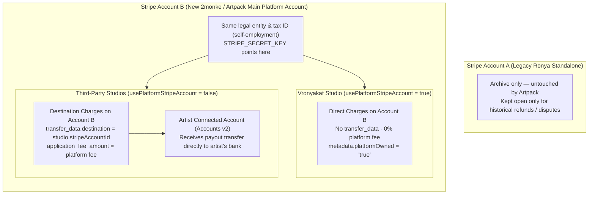

# Stripe Platform Setup & Platform-Owned Studio Mode

This document is the end-to-end setup, cutover, and operations guide for running Artpack / 2monke on a dedicated **Stripe Platform Account (Account B)** registered under the platform owner's existing self-employment (same tax ID as the legacy Ronya Studio account), with **Vronyakat Studio** operating in **Platform-Owned Studio Mode** (`usePlatformStripeAccount: true`) and all third-party artists operating on **Stripe Connect (Accounts v2 + Destination Charges)**.

---

## 1. Account Architecture



### Why this layout?
1. **Stripe forbids self-transfers:** A platform account cannot pass its own `acct_...` ID in `transfer_data.destination`.
2. **Avoids self-onboarding compliance flags:** Creating a Connected Account for the exact same sole proprietor + tax ID + bank account underneath your own platform triggers Stripe Connect risk/circular-account checks and adds pointless Connect transfers to yourself.
3. **Zero downtime on legacy Ronya:** Keeping Account A untouched avoids breaking active Ronya orders/webhooks while Connect is being reviewed and tested on Account B.

---

## 2. Studio Payment & Fee Flags (Admin Reference)

Never confuse `usePlatformStripeAccount` with `waivePlatformFees`:

| Field on `Studios` (Admin-only) | Who should have it | Where money goes | Fee collected |
|---|---|---|---|
| **`usePlatformStripeAccount: true`** | **ONLY your own studio** (`std_vronyakat`) | Directly into **Account B** (no transfer) | **0%** (platform pays Stripe card fee directly on its own sales) |
| **`waivePlatformFees: true`** *(or `platformFeePercent: 0`)* | **Other artists** (friends, beta artists, co-founders) | Transferred to **the artist's** Connected Account | **0% commission** + **3.5% + €0.30** processing-cost floor (`PROCESSING_FLOOR_SPEC`) so Account B never loses money paying Stripe's card fee |
| *(Defaults)* | **Standard third-party studios** | Transferred to **the artist's** Connected Account | Launch period **5%** (min €0.50); steady-state **10%** (see `src/lib/stripe/fee-schedule.ts`) |

> [!CAUTION]
> Never enable `usePlatformStripeAccount` on a third-party artist's studio — 100% of their sales would settle into the platform's own bank account instead of theirs.

---

## 3. Step-by-Step Stripe Dashboard Setup (Account B)

### Step 1 — Create Account B under the same self-employment / tax ID
1. Log into your existing Stripe Dashboard (Account A).
2. Open the **top-left account switcher** → click **+ Create account**.
3. Name it after the platform (e.g. `2monke` / `Artpack`).
4. Complete activation using the **same Individual / Sole Proprietor legal entity, tax ID, and bank account** (Stripe explicitly permits multiple accounts under one legal entity).

### Step 2 — Configure Business Details & Branding
In **Settings → Business details → Public details**:
* **Public business name:** `2monke` (or your platform brand).
* **Statement descriptor:** Keep short and recognizable (with destination charges, the platform's descriptor appears on buyers' bank statements).
* **Support email / URL / Privacy & Terms URLs:** Point to your production platform URLs.

### Step 3 — Activate & Approve Stripe Connect
1. Go to **Connect → Get Started** in Account B.
2. Complete the **Connect Platform Profile** accurately:
   * **Business model:** Multi-artist commission & digital art marketplace.
   * **Charge flow:** Destination charges (`transfer_data.destination`) with `application_fee_amount`.
   * **Liability & fees:** Platform collects fees and covers negative-balance liability (`losses_collector: "application"` — matching `src/lib/stripe/account-creation.ts` Accounts v2 configuration).
   * **Moderation / Refund policy:** Clearly state your art/IP/prohibited-content rules and full-refund unwinding flow (`src/lib/stripe/sale-refund.ts`).
3. Configure **Connect → Settings → Onboarding / Branding** (platform logo, brand color, icon) so the hosted Stripe onboarding screens match Artpack.

### Step 4 — Enable Stripe Tax
Artpack passes `automatic_tax: { enabled: true }` on commission and shop checkouts:
1. Go to **Settings → Tax** on Account B and enable **Stripe Tax**.
2. Set the origin address (matching your wife's self-employment registration) and default tax category (Digital Goods / Services).
3. Add any active VAT / tax registrations required for your country/EU threshold.
4. Confirm with your accountant how **third-party marketplace pass-through sales** (`transfer != null`) vs. **your own studio sales** (`metadata.platformOwned = 'true'`, `transfer == null`) should be booked for VAT thresholds and income reporting.

### Step 5 — Configure Webhooks
Artpack's webhook handler lives at:

```text
https://<your-production-domain>/api/stripe/webhooks
```

Subscribe to the following events:

| Event | Source | Handled by |
|---|---|---|
| `checkout.session.completed` | **Your account** | Commission / shop / tip fulfillment (`handleCheckoutSessionCompleted`) |
| `checkout.session.async_payment_succeeded` | **Your account** | Delayed payment methods (`handleCheckoutSessionAsyncPaymentSucceeded`) |
| `checkout.session.async_payment_failed` | **Your account** | Failed delayed payments (`handleCheckoutSessionAsyncPaymentFailed`) |
| `charge.refunded` | **Your account** | Full-refund state sync + fee/transfer unwind (`handleChargeRefunded`) |
| `account.updated` | **Connected accounts** | Syncs artist `stripeChargesEnabled` / `stripePayoutsEnabled` / `profileStatus` (`handleAccountUpdated`) |

> [!IMPORTANT]
> In Stripe, a **Connected accounts** webhook has a **different signing secret (`whsec_...`)** than a **Your account** webhook.
> `src/app/api/stripe/webhooks/route.ts` currently verifies signatures using `process.env.STRIPE_WEBHOOK_SECRET` alone. Either:
> * Configure a unified Stripe **Event Destination** / single signing secret if your Stripe dashboard offers it, **or**
> * Add `STRIPE_CONNECT_WEBHOOK_SECRET` fallback verification in `src/app/api/stripe/webhooks/route.ts` before relying on `account.updated` webhooks in production (note: `/api/stripe/connect/status` also syncs live status on page visit as a fallback).

### Step 6 — Set Environment Variables (Vercel / Production)
Update your deployment env vars with **Account B's live keys**:
* `STRIPE_SECRET_KEY=sk_live_...` (from Account B)
* `NEXT_PUBLIC_STRIPE_PUBLISHABLE_KEY=pk_live_...` (from Account B)
* `STRIPE_WEBHOOK_SECRET=whsec_...` (from Account B's webhook endpoint)

---

## 4. Production Cutover Checklist (Ronya → Artpack)

1. **Apply database migrations** on production Postgres:
   ```bash
   npm run migrate
   ```
   Ensures `20261126_120000_add_studio_platform_stripe_mode` (`studios.use_platform_stripe_account`) is present.

2. **Run the Ronya migration with Platform-Owned + Fresh Stripe flags:**
   ```bash
   npm run migrate:ronya:live -- --sync-s3 --platform-owned-stripe --fresh-stripe-account
   ```
   What these two flags do:
   * `--platform-owned-stripe`: sets `use_platform_stripe_account = true`, `stripe_account_id = NULL`, `stripe_charges_enabled = true`, `stripe_payouts_enabled = true`, `stripe_details_submitted = true`, and `profile_status = 'published'` on `std_vronyakat`.
   * `--fresh-stripe-account`: writes `NULL` for migrated `customers.stripe_i_d`, `products.stripe_i_d`, and `products.stripe_price_i_d` so returning customers never fail checkout with `No such customer: 'cus_...'` from Account A.

3. **Smoke test in Stripe Test Mode / Sandbox first:**
   * Verify **Admin → Payouts** for `std_vronyakat` displays the green **Platform Stripe Account** pill and *"Direct Settlement on Platform Stripe Account"* card (with no "Connect Stripe" CTA).
   * Complete one test **commission checkout**, one **shop checkout**, and one **tip checkout** on `vronyakat` — confirm in Stripe Dashboard that:
     * Charge succeeds directly on Account B with **no `transfer_data`** and **no `application_fee`**.
     * `metadata.platformOwned` is `"true"` and `metadata.platformFeeInCents` is `"0"`.
     * Full refund via `refundSaleFully` succeeds without `reverse_transfer` / `refund_application_fee` errors.
   * Complete one test checkout for a **connected third-party studio** — confirm `transfer_data.destination` and `application_fee_amount` still work normally.

4. **Post-cutover archive of Account A:**
   * Keep Account A open (do not delete it) until the chargeback/refund window (~120 days) passes on the last pre-migration Ronya order.
   * Handle any refunds for pre-migration Ronya orders directly inside Account A's Stripe Dashboard.

---

## 5. Architecture & Files Reference

| File | Role |
|---|---|
| `src/lib/stripe/platform-studio.ts` | Single source of truth: `isPlatformOwnedStripeStudio()` and `canStudioAcceptPayments()` |
| `src/lib/stripe/fee-schedule.ts` | Returns `0` platform fee (`rate: 0, fixedCents: 0`) when `usePlatformStripeAccount: true` |
| `src/collections/Studios.ts` | Admin-only `usePlatformStripeAccount` checkbox + `syncPlatformOwnedStripeFields` `beforeChange` hook |
| `src/migrations/20261126_120000_add_studio_platform_stripe_mode.ts` | Adds `studios.use_platform_stripe_account` boolean column |
| `src/features/commissions/lib/checkout.ts` | Omits `payment_intent_data` transfer/fee for platform-owned studios |
| `src/features/shop/actions/create-shop-checkout.action.ts` | Omits `payment_intent_data` transfer/fee for platform-owned studios |
| `src/features/tipping/lib/tip-checkout.ts` & `create-tip-checkout.action.ts` | Omits `payment_intent_data` transfer/fee for platform-owned studios |
| `src/lib/stripe/sale-refund.ts` | Conditionally passes `reverse_transfer` and `refund_application_fee` only when present on the charge |
| `src/app/api/stripe/connect/{status,onboard,reset,dashboard}/route.ts` | Reports `platformOwned: true` on status; blocks Connect account creation/reset/Express login |
| `src/features/studio-settings/lib/stripe-status-from-studio.ts` & `StripeConnectPanel.tsx` | Displays the Platform Stripe Account badge & direct settlement card |
| `scripts/migrate-ronya-to-artpack.ts` | `--platform-owned-stripe` and `--fresh-stripe-account` migration flags |
| `tests/int/platform-owned-stripe-studio.int.spec.ts` | Unit tests covering readiness, 0% fees, direct checkout params, status mapping, and direct refunds |
