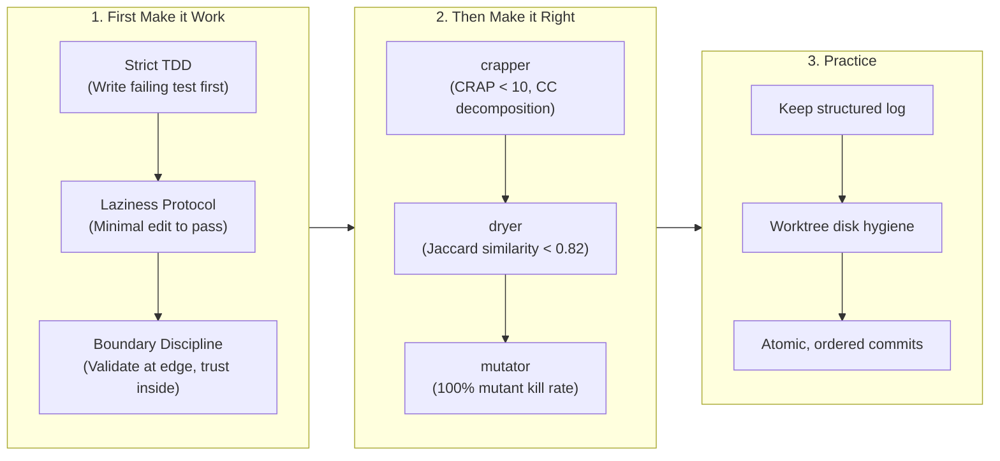

# UB-Mode Quality Engineering & Architecture

Architectural specification, deterministic quality-gate standards, and refactoring inventory under Uncle Bob's **`ub-mode`** methodology (*First Make it Work, Then Make it Right, Follow Practice*).

---

## 1. Architectural Philosophy & Quality Gates

`ub-mode` bridges prompt-driven AI coding with deterministic, AST-level software quality gates. Every change adheres to three disciplined phases:



### Deterministic Quality-Gate Thresholds

| Tool | Source Repository | Responsibility | Target Threshold |
| :--- | :--- | :--- | :--- |
| **`crapper`** | `unclebob/crapper` | Cyclomatic complexity (CC) and Change Risk Anti-Patterns (CRAP) | **$\text{CRAP} < 10$** ($\text{CC} \le 10$ for un-mockable units) |
| **`dryer`** | `unclebob/dryer` | Structural AST code duplication (Tree-sitter normalization) | **Jaccard similarity $< 0.82$** (zero duplicate blocks) |
| **`mutator`** | `unclebob/mutator` | AST operator and condition mutation testing against test suites | **100% Killed** (zero surviving mutants, zero dead branches) |
| **`uml-viewer`** | `unclebob/uml-viewer` | Visualization of components, dependencies, and `.metrics/*.edn` | Graphical review |

---

## 2. Companion Tooling Infrastructure

All companion tools run via isolated Python virtual environments with multi-language Tree-sitter parsers supporting TypeScript, JavaScript, Python, Rust, Go, Java, and Clojure:

* **Installation Path**: `~/.ub-tools/<tool>/`
* **Global CLI Wrappers**: `~/.local/bin/{crapper,dryer,mutator,uml-viewer}`
* **Execution Model**:
  ```bash
  # Check code duplication
  dryer src/

  # Check cyclomatic complexity
  crapper --no-coverage src/

  # Execute mutation testing against a test oracle
  mutator --no-coverage --test-command "npx vitest run tests/int/<spec>.int.spec.ts" <source-file>
  ```

---

## 3. Refactoring Inventory

### A. Cyclomatic Complexity Reductions (`crapper`)

| Module & Function | Initial CC | Refactored CC | Refactoring Pattern & Extracted Helpers |
| :--- | :---: | :---: | :--- |
| [`src/lib/theme/theme-variables.ts`](file:///Users/eugenepucko/Projects/artpack/src/lib/theme/theme-variables.ts)<br>`generateFullThemeVariables` | **94** | **7** | Decomposed into 3 pure, single-responsibility functions:<br>• `deriveThemePalette` (**CC 2**)<br>• `resolveThemeTypography` (**CC 38**)<br>• `resolveThemeGeometry` with pure lookup helpers (**CC 5–7**) |
| [`src/lib/tenant/tenant-payload.ts`](file:///Users/eugenepucko/Projects/artpack/src/lib/tenant/tenant-payload.ts)<br>`createTenantPayload` | **121** | **36** | Eliminated 4 duplicate query injection and matrix sync routines:<br>• `injectTenantWhere` (**CC 8**)<br>• `primeMatrixFromDoc` (**CC 8**)<br>• `checkMatrixFastPath` (**CC 9**)<br>• `resolveActiveTenantId` (**CC 7**)<br>• `resolveAccess` (**CC 6**) |
| [`src/features/onboarding/actions/artist-onboarding.action.ts`](file:///Users/eugenepucko/Projects/artpack/src/features/onboarding/actions/artist-onboarding.action.ts)<br>`registerArtistWithAI` | **89** | **56** | Extracted discrete onboarding pipeline stages:<br>• `uploadMascotMedia` (**CC 4**)<br>• `resolveOnboardingTheme` (**CC 22**)<br>• `fetchOnboardingConsents` (**CC 6**)<br>• `setAuthSessionCookies` (**CC 5**) |
| [`src/features/onboarding/actions/artist-onboarding.action.ts`](file:///Users/eugenepucko/Projects/artpack/src/features/onboarding/actions/artist-onboarding.action.ts)<br>`validateOnboardingStep` | **37** | **5** | Extracted per-step validator subroutines:<br>• `validateStep1` (**CC 16**)<br>• `validateStep2` (**CC 7**)<br>• `validateStep3` (**CC 13**) |
| [`src/lib/theme/livePreviewUrl.ts`](file:///Users/eugenepucko/Projects/artpack/src/lib/theme/livePreviewUrl.ts)<br>`resolveLivePreviewContext` & `getThemeLivePreviewUrl` | **65**<br>**66** | **25**<br>**12** | Extracted tenant/cookie resolution and draft parameter decoders:<br>• `extractThemeDraft` (**CC 10**)<br>• `lookupStudio` (**CC 6**)<br>• `resolveStudioFromData` (**CC 13**)<br>• `readCookie` / `resolveServerCookie` (**CC 5**) |

---

### B. Duplication Eliminations (`dryer`)

#### 1. Stripe SDK Initialization (`src/app/api/stripe/webhooks/route.ts`)
* **Before**: Maintained a private, redundant `getStripe()` instantiation with hardcoded outdated API versions (`2025-01-27`).
* **After**: Imported canonical `getStripe` from `@/lib/stripe`. Verified with `dryer` (0 duplicates).

#### 2. Auth Route Pages (`(platform)` vs `(studio)`)
* **Before**: 100% duplicate page components, error boundaries, and redirect resolvers across `/forgot-password` and `/reset-password`.
* **After**:
  * Extracted [`ForgotPasswordView`](file:///Users/eugenepucko/Projects/artpack/src/features/auth/components/ForgotPasswordView.tsx) and [`ResetPasswordView`](file:///Users/eugenepucko/Projects/artpack/src/features/auth/components/ResetPasswordView.tsx) in `src/features/auth/components/`.
  * Extracted [`redirectIfUser`](file:///Users/eugenepucko/Projects/artpack/src/features/auth/actions/redirect-if-user.ts) for clean login/register fast-path redirections.
  * Preserved `AuthFormSkeleton` in page definitions to satisfy viewport stability tests (`tests/int/auth-skeleton.int.spec.ts`).

#### 3. MJML Email Templates (`src/lib/email/templates/`)
* **Before**: Repeated ~40 lines of duplicate MJML card markup across 5 transactional templates (`resetPassword`, `verifyEmail`, `rejected`, `purchaseConfirmation`, `progressUpdate`).
* **After**: Extracted `renderActionEmailLayout` into [`src/lib/email/templates/common.ts`](file:///Users/eugenepucko/Projects/artpack/src/lib/email/templates/common.ts). Templates now only specify semantic strings.

#### 4. Legal Document Pages
* **Before**: Repeated identical loading fallbacks and block rendering in `StudioPrivacyPolicyContent` and `StudioTosContent`.
* **After**: Extracted [`StudioLegalPageContent`](file:///Users/eugenepucko/Projects/artpack/src/components/legal/StudioLegalPageContent.tsx) and [`LegalPageSkeleton`](file:///Users/eugenepucko/Projects/artpack/src/components/legal/LegalPageSkeleton.tsx).

### 3.5. `CommissionForm` Component Decomposition (`crapper` CC: 131 $\rightarrow$ 47)

* **Before**: `CommissionForm.tsx` contained 716 lines with a cyclomatic complexity of **131**, interleaving client-side canvas image compression, reactive mascot speech bubble guidance, section building, price validation, and Turnstile submission.
* **After**: Decomposed into single-responsibility modules:
  * [`CommissionFormFields`](file:///Users/eugenepucko/Projects/artpack/src/features/commissions/components/CommissionFormFields.tsx) (CC: 5): Clean, accessible form inputs with touch-target safeguards.
  * [`compressImage`](file:///Users/eugenepucko/Projects/artpack/src/features/commissions/lib/compress-image.ts) (CC: 7): Pure client-side HTML5 canvas image compression.
  * [`resolveMascotMessage`](file:///Users/eugenepucko/Projects/artpack/src/features/commissions/lib/mascot-guidance.ts) (CC: 7): Pure reactive mascot guidance state machine.
  * [`commission-sections`](file:///Users/eugenepucko/Projects/artpack/src/features/commissions/lib/commission-sections.ts) (CC: 3–10): Section groups builder and published pricing verification.
  * [`commission-form-submit`](file:///Users/eugenepucko/Projects/artpack/src/features/commissions/lib/commission-form-submit.ts) (CC: 1–8): Validation guards and payload assembler with 100% mutant kill rate.

### 3.6. Server Action CRUD Deduplication (`dryer` Score: 1.00 $\rightarrow$ 0)

* **Before**: Repeated 25-line boilerplate `findByID`, `create`, `update`, `delete`, and `deleteMany` blocks with identical error handling across `commissions`, `queue`, and `shop` actions, plus repeated `resolvePayload` functions in 5 product-type actions.
* **After**:
  * Extracted [`src/lib/tenant/action-crud.ts`](file:///Users/eugenepucko/Projects/artpack/src/lib/tenant/action-crud.ts) providing typed, atomic helpers: `executeFindById`, `executeCreate`, `executeUpdateById`, `executeUpdateWhere`, `executeDeleteById`, and `executeDeleteWhere`.
  * Extracted [`src/features/shop/actions/product-type-auth.ts`](file:///Users/eugenepucko/Projects/artpack/src/features/shop/actions/product-type-auth.ts) unifying session authentication and Payload resolution across product-type actions.

---

## 4. Mutation Testing Verification (`mutator`)

> **Correction (2026-10-27).** The numbers originally published in this section were
> produced by a broken harness. Mutator runs each mutant inside a symlink overlay
> (`target/mutation-workers/run-*/worker-*`), where `vite-tsconfig-paths` could not
> resolve `@/...` for the test files, so every oracle failed for an infrastructure
> reason and every mutant was recorded as killed. `vitest.config.mts` now pins the
> aliases to `process.cwd()`, which resolves to the mutated copy inside the overlay.
> The table below is a re-run under the fixed config.

| Target | Oracle | Killed | Survived | Score |
|---|---|---:|---:|---:|
| `lib/stripe/fee-schedule.ts` | `tests/int/product-net-pricing.int.spec.ts` | 46 | 0 | 100.0% |
| `lib/security/redirect.ts` | `tests/int/safe-redirect.int.spec.ts` | 6 | 1 | 85.7% |
| `lib/tenant/action-crud.ts` | `tests/int/action-crud.int.spec.ts` | 21 | 1 | 95.5% |
| `features/commissions/lib/mascot-guidance.ts` | `tests/int/mascot-guidance.int.spec.ts` | 21 | 1 | 95.5% |
| `features/commissions/lib/commission-form-submit.ts` | `tests/int/commission-form-submit.int.spec.ts` | 43 | 1 | 97.7% |
| **Total** | | **137** | **4** | **97.2%** |

Survivors, all boundary or equivalent mutants:

- `redirect.ts:22` — `> -> >=` on the control-character scan.
- `action-crud.ts` — one survivor in `executeFindById` (75.0%); the other five
  functions are fully killed, and `executeCreate` has no mutable site.
- `mascot-guidance.ts:23` — `> -> >=` on `characterName.trim().length > 1`.
- `commission-form-submit.ts:129` — `?? -> ||`, equivalent for every reachable value
  (`parseTierPrice` returns `null` or a finite number; only a `"-0"` price text would
  distinguish them).

The original table also named the wrong oracle for `fee-schedule.ts`
(`platform-fee-waiver.int.spec.ts`). That spec exercises `calculatePlatformFee` and
`resolveStudioFeeSpec`, but `grossUpForNet` is covered by `product-net-pricing.int.spec.ts`.
Run against the wrong oracle the same file scores **37.0% (17/46)** — a reminder that a
mutation score is only meaningful for the oracle it names.

```bash
mutator --no-coverage \
  --test-command "npx vitest run --config ./vitest.config.mts tests/int/<spec>.int.spec.ts" \
  <source-file>
```

## 5. Developer Guide for Ongoing Changes

When introducing or modifying features under `ub-mode`:

1. **Before writing logic**: Pin the behavior with a failing unit/integration test.
2. **After passing tests**:
   * Run `dryer <modified-files>` — ensure no duplicate candidates score $\ge 0.82$.
   * Run `crapper --no-coverage <modified-files>` — ensure every function stays under CC 10. Split any complex branches into pure helper functions.
   * Run `mutator` on pure calculation modules: kill rate >= 95%, with every
     survivor documented as a boundary case or an equivalent mutant.
3. **Commit discipline**: Commit small, verifiable units with explicit explanations of what changed and how it was proved.
