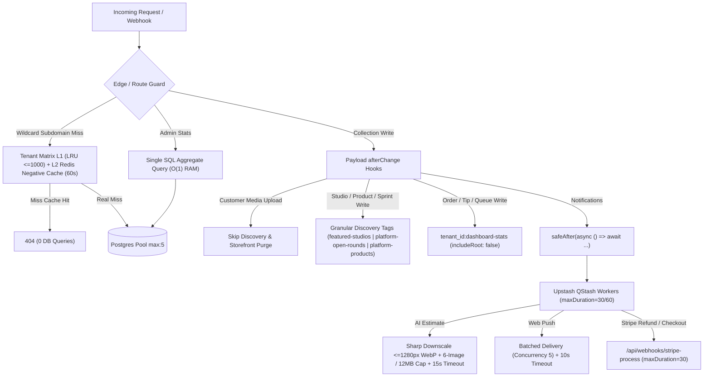

# Vercel Serverless Hardening & Reliability Architecture

## Overview

This document captures the serverless hardening pass applied to protect the platform against Vercel Serverless failure modes: **cache stampedes**, **Postgres connection pool exhaustion** (`max: 5` in production), **function timeouts**, **memory OOMs**, **silent Lambda-freeze drops of background notifications**, and **unauthenticated CPU/DB amplification vectors**.

---

## Architecture Diagram



---

## Breakdown by Hardening Area

### 1. Cache Stampede Prevention & Tenant Matrix Protection
- **Granular Platform Discovery Tags** (`src/lib/tenant/tenant-tag.ts`, `src/features/studios/cache/studios.cache.ts`):
  - Separated `PLATFORM_OPEN_ROUNDS_TAG` (`platform-open-rounds`) and `PLATFORM_PRODUCTS_TAG` (`platform-products`) from `FEATURED_STUDIOS_TAG` (`featured-studios`).
  - Product edits only invalidate `platform-products`; commission-settings edits only invalidate `platform-open-rounds`; sprint edits invalidate `featured-studios` + `platform-open-rounds`; studio edits invalidate all three.
- **Customer Upload Cache Guard** (`src/collections/hooks/revalidateMediaCache.ts`):
  - Skips studio storefront and discovery invalidation when `doc.owner.relationTo === 'customers'` (commission reference images and customer avatars never appear in studio pages, products, or discovery cards).
- **Narrow Dashboard Stats Invalidation** (`src/features/admin-dashboard/cache/dashboard.cache.ts`):
  - `fetchStudioStats` and `revalidateDashboardStats` pass `{ includeRoot: false }`, preventing order, tip, commission, and queue writes from nuking the studio's public storefront root tag (`tenant_<id>`).
- **Bounded L1 Matrix + Negative Caching** (`src/lib/matrix/state.ts`, `src/lib/matrix/engine.ts`):
  - Enforces `L1_MAX_ENTRIES` (default `1000`, override via `MATRIX_L1_MAX_ENTRIES`) with expired-entry sweep + FIFO eviction to prevent memory growth in warm containers.
  - Caches L1/L2 misses (`MATRIX_MISS_SENTINEL`, 30s L1 / 60s Redis) in `fetchEntityById` and `fetchEntityByIndex`, stopping wildcard-subdomain bot scans from penetrating to Postgres.

### 2. Postgres Pool & Unbounded Query Elimination
- **Single-Query SQL Dashboard Aggregates** (`src/features/admin-dashboard/lib/dashboard-stats.query.ts`, wrapped by `src/features/admin-dashboard/cache/dashboard.cache.ts`):
  - `computePlatformOverview` and `computeStudioStats` live in a dedicated server-only query module using typed Drizzle schema column references (`@/payload-generated-schema`) in a single `COUNT` / `SUM` / `FILTER` SQL aggregation, keeping `dashboard.cache.ts` strictly focused on `'use cache'` and tag invalidation.
- **Indexed Account Deletion Cleanup** (`src/lib/infra/cleanup.ts`):
  - Replaced the cross-tenant full-table `media` pagination loop with a direct indexed `SELECT DISTINCT parent_id FROM media_rels WHERE path = 'owner' AND ...` query.
  - Removed the dead 500-studio empty loop, narrowed artist avatar cleanup to `where: { avatar: { in: stringMediaIds } }`, parameterized raw SQL deletes, and batched `deleteMedia` with concurrency 5.
- **Cached Sitemap Products** (`src/app/sitemap.ts`):
  - Moved the per-studio product slug query into a `'use cache'` helper (`cacheLife('hours')` + `cacheTags.products(studioId)`).

### 3. Serverless Timeouts, OOM Guards & DoS Hardening
- **Explicit `maxDuration` Across Long-Running Routes:**
  - `60s`: `/api/files/[id]`, `/api/deliverables/[id]`, `/api/webhooks/ai-process`.
  - `30s`: `/api/help/ask`, `/api/ai/generate-theme`, `/api/discord/interactions`, `/api/stripe/webhooks`, `/api/webhooks/stripe-process`, `/api/webhooks/push`, `/api/webhooks/email`, `/api/webhooks/discord`.
  - `15s`: `/api/email-logo/[id]`.
- **Endpoint Rate Limiting & Input Bounds:**
  - `/api/files/[id]`: Added IP rate limiting (`apiRateLimiter`). Private streaming through the app route is intentionally preserved (no presigned S3 GET URLs, pinned by `tests/int/s3-buckets.int.spec.ts`).
  - `/api/email-logo/[id]`: Added IP rate limiting (`publicDeliverableRateLimiter`) and a `512 KB` SVG input ceiling before calling `sharp`.
  - `/api/graphql`: Disabled GraphQL Playground in production (`disablePlaygroundInProduction: true`) and set `maxComplexity: 500` in `src/payload.config.ts`.
  - `uploadAvatarAction` (`src/app/(app)/dashboard/avatar-actions.ts`): Added session + self/admin ownership verification, MIME allowlist check, and a `4 MB` file cap (safely under Vercel's hard `4.5 MB` Serverless body limit).
- **AI Commission Estimator Memory & Timeout Budget** (`src/lib/ai/estimateCommission.ts`):
  - Caps processed reference images (`MAX_AI_REFERENCE_IMAGES = 6`, `MAX_SINGLE_IMAGE_FETCH_BYTES = 15 MB`, `MAX_TOTAL_AI_IMAGE_BYTES = 12 MB`), applies `AbortSignal.timeout(15_000)` to remote image fetches, and downscales images > `512 KB` to max `1280px` WebP via `sharp`.
- **Stripe Refund Offloading** (`src/lib/stripe/stripeWebhooks.ts`):
  - `handleChargeRefunded` now offloads to QStash (`/api/webhooks/stripe-process`) in production via `shouldOffloadToQStash`, avoiding synchronous multi-call refund timeouts in `/api/stripe/webhooks`.

### 4. Background Job Durability, Outbound Timeouts & Build Safety
- **No Un-Awaited `void` Promises in Serverless Hooks/Actions:**
  - Wrapped email, push, and Discord dispatch calls in `safeAfter(async () => { await ... })` across `notifyOnChatMessage`, `notifyDiscordOnPaymentSuccess`, `notifyCustomerOnPaymentSuccess`, `notifyCustomerOnCommissionFinished`, `notifyCustomerOnReviewComplete`, `notifyDiscordOnSubmission`, and `notifyCustomerAction` so Vercel does not freeze outbound calls mid-flight.
- **Bounded Push Delivery & External Timeouts:**
  - `webPush.sendNotification` (`src/lib/push/send.ts`) now sets `timeout: 10_000`; `deliverPushToUser` and `deliverTenantArtistPush` process recipients in batches of 5 (`PUSH_BATCH_CONCURRENCY = 5`).
  - Brevo SMTP transport (`src/lib/email/email-config.ts`) sets `connectionTimeout: 10_000`, `greetingTimeout: 10_000`, `socketTimeout: 15_000`.
  - Discord webhook and interaction PATCH requests set `AbortSignal.timeout(10_000)`.
- **Build Heap & Dependencies** (`package.json`):
  - Lowered Next.js build heap ceiling from `--max-old-space-size=8000` to `--max-old-space-size=6144` for safe headroom inside standard 8 GB Vercel build containers.
  - Removed unused `discord.js` from production dependencies.

---

## Files Changed

| Area | Files |
| :--- | :--- |
| Tenant Matrix & Caching | `src/lib/matrix/state.ts`, `src/lib/matrix/engine.ts`, `src/lib/tenant/tenant-tag.ts`, `src/features/studios/cache/studios.cache.ts`, `src/app/sitemap.ts` |
| Revalidation Hooks | `src/collections/hooks/revalidateMediaCache.ts`, `revalidateProductsCache.ts`, `revalidateSprintsCache.ts`, `revalidateCommissionSettingsCache.ts`, `revalidateStudioCache.ts` |
| Dashboard & Cleanup | `src/features/admin-dashboard/cache/dashboard.cache.ts`, `src/lib/infra/cleanup.ts` |
| API Routes & Config | `src/payload.config.ts`, `src/app/api/email-logo/[id]/route.ts`, `src/app/api/files/[id]/route.ts`, `src/app/api/deliverables/[id]/route.ts`, `src/app/api/help/ask/route.ts`, `src/app/api/ai/generate-theme/route.ts`, `src/app/api/discord/interactions/route.ts`, `src/app/api/stripe/webhooks/route.ts`, `src/app/api/webhooks/{push,email,discord}/route.ts`, `src/app/(app)/dashboard/avatar-actions.ts`, `package.json` |
| AI, Stripe, Push, Email, Discord | `src/lib/ai/estimateCommission.ts`, `src/lib/stripe/stripeWebhooks.ts`, `src/lib/push/send.ts`, `src/features/push/actions/deliver-push.action.ts`, `src/lib/email/email-config.ts`, `src/lib/infra/discord.ts` |
| Notification Hooks (`safeAfter`) | `src/collections/hooks/notifyOnChatMessage.ts`, `notifyDiscordOnPaymentSuccess.ts`, `notifyCustomerOnPaymentSuccess.ts`, `notifyCustomerOnCommissionFinished.ts`, `notifyCustomerOnReviewComplete.ts`, `notifyDiscordOnSubmission.ts`, `src/features/queue/actions/comment-actions.ts` |
| Tests | `tests/int/dashboard-cache-invalidation.int.spec.ts`, `tests/int/email-logo-route.int.spec.ts`, `tests/int/revalidate-media-cache.int.spec.ts`, `tests/int/tenant-matrix.int.spec.ts` |

---

## Debug Reference

- **Verify L1 matrix size / negative cache tuning:** Override `MATRIX_L1_MAX_ENTRIES` or `MATRIX_L1_TTL_MS` in env; inspect counts via `getMatrixStats()`.
- **Verify Postgres pool health (admin only):** `GET /api/diag/pool` reports `totalCount`, `idleCount`, `waitingCount`, and `max`.
- **Debug cache tag invalidations:** Set `DEBUG_CACHE=true` to trace `[REVALIDATE]` tag emissions.
- **Verify refund QStash offload:** Look for `[WEBHOOK-OFFLOAD] Attempting to offload charge.refunded to QStash...` in `/api/stripe/webhooks` logs and `[QSTASH-WORKER] Processing Stripe event: charge.refunded` in `/api/webhooks/stripe-process`.
- **Run hardening regression specs:**
  ```bash
  yarn test:unit tests/int/tenant-matrix.int.spec.ts tests/int/revalidate-media-cache.int.spec.ts tests/int/featured-studios-invalidation.int.spec.ts tests/int/tenant-tag-revalidate.int.spec.ts tests/int/email-logo-route.int.spec.ts tests/int/ai-percentage-estimate.int.spec.ts tests/int/s3-buckets.int.spec.ts
  npx vitest run --config ./vitest.config.mts tests/int/dashboard-cache-invalidation.int.spec.ts
  ```
